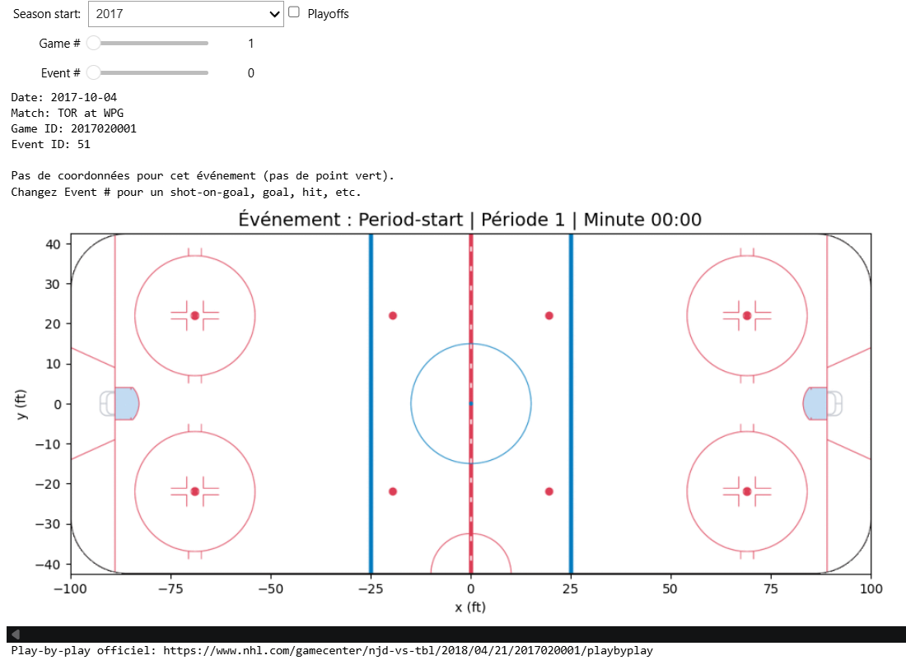
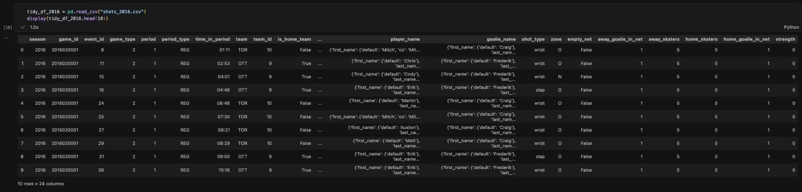
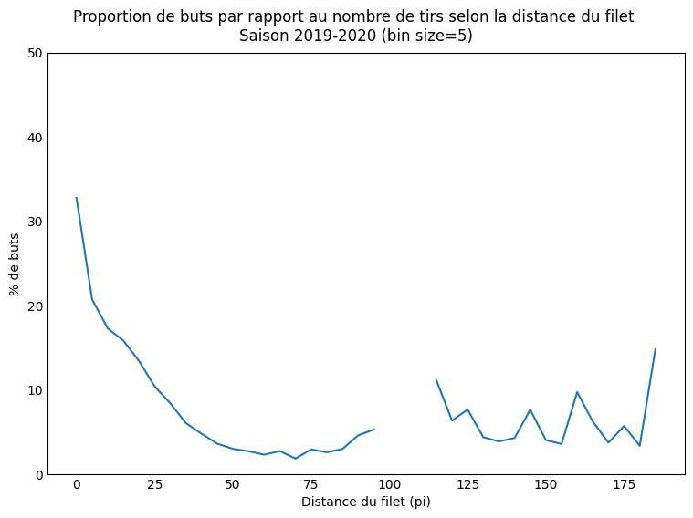
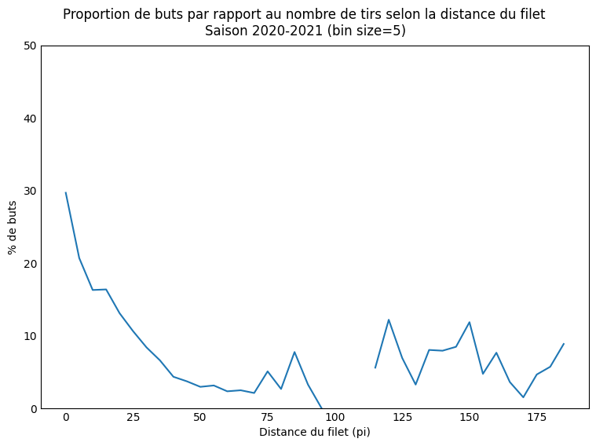
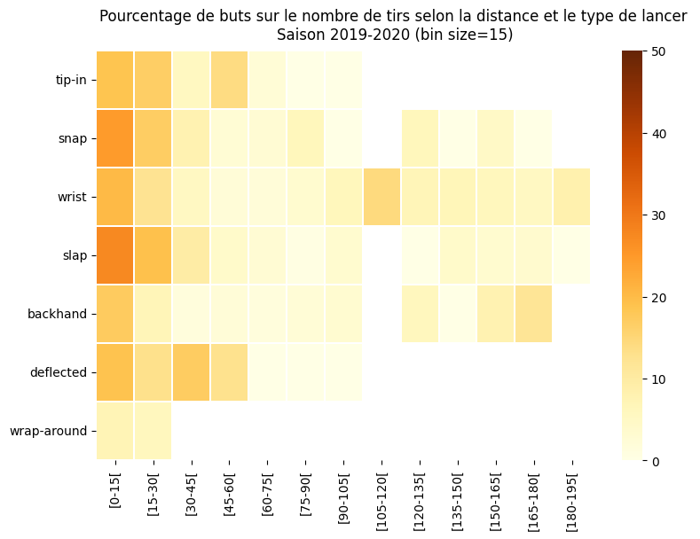

# 1\. Acquisition de données

## Question 1

> [!TIP]
> **Rédigez un bref tutoriel** expliquant comment votre équipe a téléchargé l'ensemble de données. Imaginez :) que vous cherchiez un guide pour télécharger les données play-by-play ; votre guide devrait vous faire dire « Parfait \- c'est exactement ce que je cherchais\! ». **Incluez votre fonction/classe** et **fournissez un exemple de son utilisation**. Assurez-vous de ne pas seulement démontrer que votre code fonctionne \- c'est aussi un exercice de documentation et de communication de votre implémentation. Cela n'a *pas* besoin d'être extrêmement compliqué, mais nous nous attendons à quelque chose d'un peu plus cohérent et digeste que de simples captures d'écran de vos fonctions/code.

Voici comment notre équipe a téléchargé l'ensemble de données play-by-play de 2016-17 à 2023-24.

### Guide rapide

Depuis le dossier `data_science_project` :

```bash
uv sync                 # Créé un .venv et installe tout le nécéssaire
uv run download-nhl     # télécharge 2016-17 à 2023-24 (long la première fois)
# Options : `--first 2019 --last 2019` (une seule saison), `--data-dir CHEMIN` (dossier de sauvegarde) et `--delay 0.5` (pause en secondes entre deux requêtes). Le téléchargement peut être interrompu (Ctrl+C) puis relancé. Les matchs déjà sauvegardés sont sautés.
# ex: `uv run download-nhl --first 2019 --last 2019`
```

#### 1. Le point d'accès

L'API web de la LNH retourne un fichier JSON par match :

```
https://api-web.nhle.com/v1/gamecenter/{GAME_ID}/play-by-play
```

Ce JSON contient les événements du match (tirs, buts, mises au jeu, etc.) avec leur période, leur temps et leurs coordonnées sur la patinoire. Pour une saison spécifiée, on télécharge chaque match **une seule fois** et on le garde sur le disque (cache).

#### 2. L'identifiant d'un match

Un `GAME_ID` a 10 chiffres : `AAAA TT NNNN`.

- `AAAA` : année de début de la saison (`2016` pour 2016-17)
- `TT` : type de match, `02` pour la saison régulière et `03` pour les séries
- `NNNN` : en saison régulière, le numéro du match (`0001`, `0002`, ...). En séries, `0RMG` : la ronde (1 à 4), la série dans la ronde et le match de la série (1 à 7)

Par exemple, `2022030411` est la saison 2022-23, séries, ronde 4 (la finale), série 1, match 1. 
Il y a 8 séries en ronde 1, 4 en ronde 2, 2 en ronde 3 et 1 en ronde 4 (la finale).

```python
def regular_season_game_id(season: int, number: int) -> str:
    return f"{season}02{number:04d}"

def playoff_game_id(season: int, round_: int, matchup: int, game: int) -> str:
    return f"{season}030{round_}{matchup}{game}"
```

#### 3. Le cœur `get_game` avec cache

```python
def get_game(game_id, data_dir=None, session=None, delay=0.5):
    path = _cache_path(game_id, data_dir)
    if path.exists():                       # 1. déjà téléchargé : on lit le disque
        return json.loads(path.read_text())

    resp = (session or requests).get(PBP_URL.format(game_id=game_id), timeout=30)
    time.sleep(delay)                       # 2. pause pour ne pas surcharger l'API
    if resp.status_code == 404:             # 3. ce match n'existe pas
        return None
    resp.raise_for_status()

    data = resp.json()
    path.parent.mkdir(parents=True, exist_ok=True)
    path.write_text(json.dumps(data))       # 4. on sauvegarde le JSON brut
    return data
```

La fonction vérifie d'abord le cache. Le premier appel télécharge et sauvegarde, et les suivants lisent le disque sans aucune requête. Un `404` n'est pas une erreur. C'est normal, par exemple pour un match 7 qui n'a pas eu lieu parce que la série s'est terminée en 5 matchs. Et donc, on retourne alors `None`. Sinon, les autres erreurs HTTP sont levées.

Le dossier de sauvegarde est choisi dans cet ordre : l'argument `data_dir`, la variable d'environnement `NHL_DATA_DIR`, puis `ift6758/data/raw/` par défaut.

```python
def get_data_dir(data_dir=None) -> Path:
    path = Path(data_dir or os.environ.get("NHL_DATA_DIR", "data/raw"))
    path.mkdir(parents=True, exist_ok=True)
    return path

def _cache_path(game_id, data_dir):
    return get_data_dir(data_dir) / game_id[:4] / f"{game_id}.json"
```

Chaque membre de l'équipe peut ainsi mettre les données où il veut (`$env:NHL_DATA_DIR = "D:\nhl"` sous PowerShell, `export NHL_DATA_DIR=~/nhl` sous macOS/Linux) sans conflit de chemins dans git. Les données ne sont jamais commitées dans `data/raw/`. En effet, `data/raw/` est dans le `.gitignore`.

#### 4. Télécharger une saison

On boucle sur les identifiants (version simplifiée, sans barre de progression).

**Saison régulière.** On ne connaît pas à l'avance le nombre de matchs, car il varie d'une saison à l'autre (expansion, COVID). On compte donc 1, 2, 3, ... et on s'arrête après 5 matchs inexistants consécutifs.

```python
def download_regular_season(season, data_dir=None, session=None, delay=0.5, max_misses=5):
    games, misses = [], 0
    for number in range(1, MAX_REGULAR_SEASON_GAMES + 1):
        data = get_game(regular_season_game_id(season, number), data_dir, session, delay)
        if data is None:
            misses += 1
            if misses >= max_misses:
                break
            continue
        misses = 0
        games.append(data)
    return games
```

**Séries.** On parcourt chaque ronde, chaque série et les matchs 1 à 7, et on passe à la série suivante dès qu'un match manque, soit {round: matchups}

```python
MATCHUPS_PER_ROUND = {1: 8, 2: 4, 3: 2, 4: 1}

def download_playoffs(season, data_dir=None, session=None, delay=0.5):
    games = []
    for round_, n_matchups in MATCHUPS_PER_ROUND.items():
        for matchup in range(1, n_matchups + 1):
            for game in range(1, 8):
                data = get_game(playoff_game_id(season, round_, matchup, game), data_dir, session, delay)
                if data is None:
                    break               # la série est terminée
                games.append(data)
    return games
```

`download_season(season, data_dir)` appelle les deux et retourne `{"regular": [...], "playoffs": [...]}`.

#### 5. Exemple d'utilisation

```python
from ift6758.data import get_game, download_season

game = get_game("2022030411")                  # 1er appel : télécharge ; 2e appel : lit le disque
print(list(game.keys()))
print(len(game["plays"]), "événements")

season = download_season(2019, "data/raw")     # saison 2019-20 dans le dossier data/raw
print({k: len(v) for k, v in season.items()})
```

Pour tout télécharger d'un coup : `uv run download-nhl` (~15min par saison la première fois sur nos machines).

## Question 2

> [!TIP]
> **[IFT6758 seulement]** Comparez le comportement de récupération, de mise en cache et de chargement de votre code manuel et de votre code généré par le LLM à l'aide des mêmes tests : un match connu, un accès au cache sans nouvelle requête, et une requête qui échoue. Vérifiez les deux implémentations par rapport aux résultats attendus. Rapportez les itérations de prompts et toute correction manuelle nécessaire.

### Méthode

Le code LLM est généré avec Qwen (`ask_qwen`, module `ift6758/llm/qwen.py`). Le prompt contient des extraits de la documentation de l'API NHL, retrouvés par RAG (`retrieve_sections`), puis la liste des exigences du projet : `requests`, `pathlib` et `json`, `timeout=30`, `raise_for_status()`, validation de `id` (int) et de `plays` (list), cache JSON en UTF-8. La fonction demandée s'appelle `fetch_season_llm(season_id, cache_dir)`.

Les deux implémentations (la nôtre, `get_game` / `download_season`, et `fetch_season_llm`) passent les mêmes trois tests :

| Test | Résultat attendu |
|---|---|
| **Match connu** | Le match est récupéré et contient `id` (int) et `plays` (list). |
| **Cache** | Un deuxième appel relit le fichier et **ne fait aucune requête réseau**. |
| **Erreur HTTP** | Une réponse en erreur (4xx/5xx) lève une exception et n'écrit **rien** dans le cache. |

Le code généré est nettoyé avant d'être enregistré : on retire les balises Markdown (` ```python `) avec `removeprefix` / `removesuffix`. Sans ce nettoyage, le fichier `question_1_llm.py` n'était pas du Python valide (deuxième essai de la première itération : problème d'indentation causé par le `strip`).

### Itérations de prompts

| # | Changement | Ce que Qwen a produit | Match connu | Cache | Erreur HTTP |
|---|---|---|:-:|:-:|:-:|
| 1 | Prompt initial : « récupérer la saison, saison régulière et séries » | Appelle `/v1/gamecenter/{season_id}/play-by-play` : l'identifiant de **saison** est utilisé comme identifiant de **match**. Les commentaires du code avouent un *placeholder* (« fetch a representative game »). | Échec | Non testé | Succès |
| 2 | Question de RAG ajoutée sur la construction des identifiants de match | Boucle sur `game_type` ∈ {2, 3}, mais **le même URL** est appelé deux fois. Les `plays` sont fusionnés et l'`id` du résultat est faux (`all_plays[0]['id']`). | Échec | Non testé | Succès |
| 3 | Prompt précisé : `season_id` est l'année de début, une requête utilise un `game_id`, « tous les matchs » | **[À COMPLÉTER : décrire le code produit]** | Échec | Non testé | **Échec** (régression) |
| 4 | « Pas de données simulées, factices ou codées en dur » | Invente un endpoint `/v1/gamecenter/play-by-play?season=…&game-type=…` qui n'existe pas dans la documentation. Il suppose que la réponse est une **liste** de matchs. | Échec | Non testé | Succès* |
| 5 | Prompt corrigé (exigence « tous les matchs » retirée) et correction de **notre** test de cache (voir plus bas) | Même problème : aucun `game_id` n'est construit. | Échec | Non testé | Succès* |
| 6 | RAG réduit à deux questions (calendrier d'équipe, play-by-play d'un match) avec `assert` sur les endpoints attendus | Idem. | Échec | Non testé | Succès* |
| 7 | Structure du cache imposée : `cache_dir/<saison>/<game_id>.json` | Première version qui énumère les matchs avec le calendrier (`club-schedule-season`) puis demande le play-by-play de chaque match, avec le cache demandé. Mais l'URL du calendrier est invalide (`now` à la place d'un code d'équipe), le sous-dossier de la saison n'est jamais créé, le calendrier est retéléchargé même si le cache existe, et les séries éliminatoires sont lues dans une réponse qui ne contient pas les matchs. | Échec | Non testé | Succès* |

\* Ce « succès » est peu probant : l'endpoint inventé répond par une erreur, donc `raise_for_status()` lève bien une exception, mais pour la mauvaise raison. Le test ne prouve pas que la gestion d'erreur est correcte, seulement qu'un appel invalide échoue.

### Résultat final

| Implémentation | Match connu | Réutilisation du cache | Erreur HTTP |
|---|:-:|:-:|:-:|
| Manuelle | Succès | Succès | Succès |
| Qwen | Échec | Non testé | Succès* |

**Notre code manuel** réussit les trois tests. Il construit lui-même les identifiants (`regular_season_game_id`, `playoff_game_id`), met chaque match en cache dans `<saison>/<game_id>.json`, relit le fichier au lieu de refaire la requête, et lève une exception sur une erreur HTTP.

**Le code généré** échoue dès le premier test. Comme aucun match n'est récupéré, le test de cache ne peut pas s'exécuter : il est « Non testé », ce qui n'est pas un échec du cache lui-même.

### Analyse

- **L'erreur de fond est conceptuelle, pas syntaxique.** L'API NHL n'a pas d'endpoint « toute la saison » : il faut énumérer les matchs puis faire une requête par match. Les itérations 1 à 6 n'y arrivent pas (identifiant de saison utilisé comme identifiant de match, endpoint inventé). L'itération 7 trouve la bonne stratégie (calendrier, puis play-by-play de chaque match), mais l'exécute mal : URL du calendrier invalide (`now` au lieu d'un code d'équipe), dossier de cache de la saison jamais créé, et séries éliminatoires lues dans un endpoint qui ne liste pas les matchs.
- **Le cache ne respecte pas l'exigence « aucune requête réseau ».** Le calendrier est téléchargé avant de regarder le cache, donc même avec un code corrigé, le test de réutilisation du cache échouerait.
- **La validation est plus faible que demandée.** Les types de `id` et `plays` ne sont pas vérifiés, et les données invalides sont ignorées sans erreur, ce qui fait perdre des matchs sans prévenir.
- **Le RAG a retrouvé le bon endpoint**, mais il retrouve aussi du bruit (journaux de joueurs, « distance skated »). Les `assert` de l'itération 6 servent à vérifier le contexte avant la génération, mais un contexte correct n'a pas suffi.
- **Plus de contraintes dans le prompt n'a pas amélioré le résultat.** L'itération 3 a même dégradé le test d'erreur HTTP, et l'itération 4 a poussé le modèle à inventer un endpoint plutôt qu'à construire les identifiants.
- **Le LLM respecte bien la partie « mécanique »** : `timeout=30`, `raise_for_status()`, validation de `id` / `plays` et écriture UTF-8 sont présents dans chaque version. C'est la logique propre à l'API qui manque.

### Corrections manuelles

- Nettoyage des balises Markdown et de l'indentation avant d'enregistrer le fichier (voir Méthode).
- Correction de **notre propre test** de cache à l'itération 5 : notre code échouait au test de cache (« Échec » aux itérations 1 à 4) alors que le cache fonctionnait. C'était le test qui était incorrect. **[À COMPLÉTER : en une phrase, ce qui était faux dans le test]**
- Le code de Qwen n'a **pas** été réparé à la main. Pour qu'il passe les tests, il faudrait au minimum : (1) remplacer `now` par une source valide de matchs, (2) créer `cache_file.parent` avec `mkdir(parents=True, exist_ok=True)`, (3) vérifier le cache avant tout appel réseau, (4) lever `ValueError` au lieu d'ignorer silencieusement les données invalides, (5) lire les matchs de séries dans le bon endpoint. Cela représente une réécriture d'une bonne partie de la fonction. Nous avons donc gardé notre implémentation manuelle.

# 2\. Outil de débogage interactif

## Question 1

> [!TIP]
> **Implémentez un ipywidget** (ou un outil interactif de votre choix) qui vous permet de parcourir tous les événements, pour chaque match d'une saison donnée, avec la possibilité de basculer entre la saison régulière et les séries éliminatoires. **Dessinez les coordonnées de l'événement sur l'image de la patinoire fournie**, comme dans l'exemple ci-dessous (vous pouvez simplement afficher les données de l'événement lorsqu'il n'y a pas de coordonnées). Vous pouvez également afficher toute information que vous jugez utile, comme les métadonnées du match/boxscores et les résumés d'événements (mais ce n'est pas obligatoire). **Prenez une capture d'écran de l'outil et ajoutez-la à l'article de blog**, accompagnée du **code de l'outil** et d'une brève description (1-2 phrases) de ce que fait votre outil. Vous n'avez pas à vous soucier d'intégrer l'outil dans l'article de blog.
>
> ***Remarque** : Un bon test de cohérence consiste à comparer un match spécifique avec les données disponibles sur le site web de la LNH, dont un exemple se trouve [ici](https://www.nhl.com/gamecenter/wpg-vs-tor/2017/10/04/2017020001/playbyplay). Vous remarquerez que les coordonnées des événements y sont aussi dessinées, ce qui vous permet de vérifier si vos figures sont valides. Pour vous inspirer, une capture d'écran de l'outil que j'ai rapidement créé se trouve ci-dessous. Mis à part la figure, vous n'avez pas besoin de reproduire cette mise en page ; n'hésitez pas à ajouter toute information que vous jugez utile\!*

Notre outil est un widget `ipywidgets` qui permet de parcourir tous les événements de chaque match d'une saison (de 2016-17 à 2023-24) en basculant entre la saison régulière et les séries. L'événement choisi est dessiné sur l'image de la patinoire (un point vert, ou un message s'il n'a pas de coordonnées) avec les informations du match et un lien vers la page officiel de la LNH pour pouvoir comparer.


*Capture d'écran de l'outil : match 2017020001 (Toronto à Winnipeg, 4 octobre 2017)

#### Utilisation

Depuis `data_science_project`, on installe l'environnement avec `uv sync`, on télécharge au moins une saison (par exemple `uv run download-nhl --first 2017 --last 2017`), puis on ouvre `ift6758/visualizations/ipywidgets.ipynb` avec le noyau du `.venv` et on exécute les cellules. L'outil lit seulement les matchs déjà téléchargés et n'appelle jamais l'API. Si rien n'est téléchargé pour la sélection, il l'indique et donne la commande à lancer.

Il y a quatre contrôles :

- `Season start` : la saison (`2016` pour 2016-17).
- `Playoffs` : coché pour les séries, décoché pour la saison régulière.
- `Game #` : le numéro du match, de 1 au nombre de matchs téléchargés. Son maximum s'ajuste selon la saison et selon la case `Playoffs`.
- `Event #` : la position de l'événement dans le match (de 0 au nombre d'événements - 1). Ce n'est pas l'`Event ID` affiché, qui est l'identifiant de l'événement dans les données de la LNH.

#### Code

```python
import ipywidgets as widgets
import matplotlib.pyplot as plt
from pathlib import Path
from IPython.display import display

from ift6758.data import get_game
from ift6758.data.nhl import GAME_TYPE_CODE, get_data_dir

# Racine du projet (dossier qui contient pyproject.toml) : sert à trouver l'image de la patinoire
ROOT = next(p for p in [Path.cwd(), *Path.cwd().parents] if (p / "pyproject.toml").exists())

# Image de la patinoire : 200 pi x 85 pi, centrée en (0, 0)
RINK = plt.imread(ROOT / "figures" / "nhl_rink.png")
RINK_EXTENT = [-100, 100, -42.5, 42.5]

# --- Les 4 widgets ---------------------------------------------------------
season_widget = widgets.Dropdown(options=list(range(2016, 2024)), value=2017, description="Season start:")
playoffs_widget = widgets.Checkbox(value=False, description="Playoffs", indent=False)
game_widget = widgets.IntSlider(value=1, min=1, max=1, description="Game #", continuous_update=False)
event_id_widget = widgets.IntSlider(value=0, min=0, max=0, description="Event #", continuous_update=False)


def list_game_ids(season, playoffs):
    """Identifiants des matchs déjà téléchargés pour la saison (saison régulière ou séries)."""
    game_type = "playoffs" if playoffs else "regular"
    folder = get_data_dir() / str(season)
    if not folder.exists():
        return []
    # le nom du fichier sans l'extension est l'identifiant du match; le tri garde l'ordre des matchs
    return sorted(p.stem for p in folder.glob(f"{season}{GAME_TYPE_CODE[game_type]}*.json"))


def inspect_event(season, playoffs, game_number, event_number):
    """Affiche les infos du match et dessine l'événement choisi sur la patinoire."""
    ids = list_game_ids(season, playoffs)
    if not ids:
        print(f"Aucune partie téléchargée pour cette sélection dans {get_data_dir()}.")
        print("Téléchargez la saison avec : uv run download-nhl --first <année> --last <année>")
        return

    # les numéros affichés commencent à 1 (match) et 0 (événement); on borne pour ne pas dépasser
    game = get_game(ids[min(game_number, len(ids)) - 1])
    plays = game.get("plays") or []
    if not plays:
        print("Cette partie ne contient aucun événement.")
        return
    play = plays[min(event_number, len(plays) - 1)]

    details = play.get("details") or {}
    x, y = details.get("xCoord"), details.get("yCoord")
    etype = play.get("typeDescKey", "?")
    period = play.get("periodDescriptor", {}).get("number", "?")
    time_in_period = play.get("timeInPeriod", "?")

    # infos du match
    away = game.get("awayTeam", {}).get("abbrev", "?")
    home = game.get("homeTeam", {}).get("abbrev", "?")
    game_id, date = game.get("id"), game.get("gameDate", "")
    print("Date:", date)
    print("Match:", away, "at", home)
    print("Game ID:", game_id)
    print("Event ID:", play.get("eventId", "?"))

    # patinoire + point vert à l'endroit de l'événement
    fig, ax = plt.subplots(figsize=(10, 4.5))
    ax.imshow(RINK, extent=RINK_EXTENT)
    if x is not None and y is not None:
        ax.scatter([x], [y], s=150, c="tab:green", edgecolors="black", zorder=3)
        print(f"Coordonnées : x={x}, y={y}")
    else:
        print("Pas de coordonnées pour cet événement (pas de point vert).")  # arrêt de jeu, début de période, etc.
    ax.set_xlim(-100, 100)
    ax.set_ylim(-42.5, 42.5)
    ax.set_xlabel("x (ft)")
    ax.set_ylabel("y (ft)")
    ax.set_title(f"Événement : {etype.capitalize()} | Période {period} | Minute {time_in_period}", fontsize=14)
    plt.tight_layout()
    plt.show()
    plt.close(fig)

    # lien vers la page officielle du match pour comparer les coordonnées
    print(f"Play-by-play officiel: https://www.nhl.com/gamecenter/{home.lower()}-vs-{away.lower()}"
          f"/{date.replace('-', '/')}/{game_id}/playbyplay")


# --- Lier les widgets entre eux --------------------------------------------
def update_game_range(change=None):
    """Saison ou séries changés : ajuster le nombre de matchs et revenir au premier."""
    n_games = len(list_game_ids(season_widget.value, playoffs_widget.value))
    game_widget.max = max(n_games, 1)
    game_widget.value = 1
    update_event_range()


def update_event_range(change=None):
    """Match changé : ajuster le nombre d'événements et revenir au premier."""
    ids = list_game_ids(season_widget.value, playoffs_widget.value)
    n_events = len(get_game(ids[game_widget.value - 1]).get("plays") or []) if ids else 0
    event_id_widget.max = max(n_events - 1, 0)
    event_id_widget.value = 0


# Les observateurs sont enregistrés AVANT interactive_output : les sliders sont ajustés avant le dessin
season_widget.observe(update_game_range, names="value")
playoffs_widget.observe(update_game_range, names="value")
game_widget.observe(update_event_range, names="value")
update_game_range()

# Un seul interactive_output relié aux 4 widgets : il redessine dès que l'un d'eux change
out = widgets.interactive_output(
    inspect_event,
    {"season": season_widget, "playoffs": playoffs_widget,
     "game_number": game_widget, "event_number": event_id_widget},
)
display(widgets.VBox([widgets.HBox([season_widget, playoffs_widget]), game_widget, event_id_widget, out]))
```

Le point important est l'ordre des observateurs. Les curseurs `Game #` et `Event #` sont ajustés **avant** le dessin, sinon la figure serait redessinée avec une valeur hors limites quand on change de saison ou de match.

#### Test de cohérence

Pour vérifier que les coordonnées sont bien dessinées, nous avons parcouru le match du 4 octobre 2017 (`2017020001`, Toronto à Winnipeg), qui compte 305 événements dont 9 buts. Les 9 buts sont tous en zone offensive, à `|x|` entre 62 et 85 pi (les filets sont à ±89 pi). Les côtés sont aussi cohérents : Toronto marque à `x > 0` en 1re et 3e périodes (`x` = 84, 62 et 84, puis 68, 85 et 84) et à `x < 0` en 2e période (`x` = -82), tandis que Winnipeg marque à `x < 0` en 3e période (`x` = -82 et -80). Cela correspond au changement de côté des équipes à chaque période. Environ un événement sur six (50 sur 305) n'a pas de coordonnées, par exemple les arrêts de jeu et les débuts de période. L'outil affiche alors seulement ses informations, sans point vert.


# 3\. Données ordonnées


## Question 1


> Dans votre article de blog, **incluez un petit extrait** de votre dataframe final (ex. avec [head(10)](https://pandas.pydata.org/docs/reference/api/pandas.DataFrame.head.html)). Vous pouvez simplement inclure une capture d'écran plutôt que de vous battre pour que les tableaux soient bien formatés en HTML/markdown.

> 

>   Vous remarquerez que le champ « force » (c.-à-d. forces égales, avantage numérique, désavantage numérique) n'existe que pour les buts, pas pour les tirs. De plus, il n'inclut pas le nombre réel de joueurs sur la glace (c.-à-d. 5 contre 4, ou 5 contre 3, etc.). **Discutez** de la façon dont vous pourriez ajouter l'information réelle sur la force (c.-à-d. 5 contre 4, etc.) *aux tirs et aux buts*, compte tenu des autres types d'événements (au-delà des tirs et des buts) et des caractéristiques disponibles. Vous n'avez pas besoin de l'implémenter pour cette étape.

Nous faisons le calcul des forces selon le nombre de joueurs total sur la patinoire avec le situationCode (ABCD) où A = 0 ou 1 pour gardien "away" dans son filet ou pas, B = nombre de joueurs "away autres que le gardien, C = nombre de joueurs "home" autres que le gardien, D = 0 ou 1 pour gardien "home" dans son filet ou pas. Nous avons donc la possibilité de connaître la situation (ou "strength") avec le check: 

```python
# Préparation de la table pour les données de force égales
# On zip la liste des champs respectifs avec le situationCode (string) que l'on a transformé en une liste de int
# pour en faire un dictionnaire que l'on normalise ensuite
situations = (pd.json_normalize(
    shots['situation'].apply(
        lambda df: dict(zip(
            ['away_goalie_in_net', 'away_skaters', 'home_skaters', 'home_goalie_in_net'],
            map(int, list(df))))
        )))

# Avantage numérique si (home_goalie_in_net + #home_skaters) - (#away_goalie_in_net + #away_skaters) > 0 et événement de home_team
situations['strength'] = (
    ((situations['home_goalie_in_net']+situations['home_skaters']) - (situations['away_goalie_in_net']+situations['away_skaters']))
    *((shots["team_id"] == home_team).map({True: 1, False: -1})))
```

## Question 2

> [!TIP]
> En quelques phrases, **discutez d'au moins 3 caractéristiques supplémentaires** que vous pourriez envisager de créer à partir des données disponibles dans cet ensemble de données. Nous ne cherchons pas de réponses particulières, mais si vous avez besoin d'inspiration : un tir ou un but pourrait-il être classé comme un [rebond](https://www.youtube.com/watch?v=-0FiO4jjFuA)/[tir en contre-attaque](https://www.youtube.com/watch?v=V2pjERKAc_8) (expliquez comment vous les identifieriez\!) ?
>    1. **[IFT6758 seulement]** Demandez à un LLM de générer la logique de transformation Pandas pour l'une de vos 3 caractéristiques (ex. rebond). En 2–3 phrases, évaluez l'exactitude et la gestion des cas limites du code généré par le LLM par rapport à votre implémentation manuelle.
>    2. **[IFT6758 seulement]** Refaites entièrement le nettoyage des données avec un LLM et comparez le résultat final et le code à votre méthode.

### Caractéristiques supplémentaires

**1. Distance au filet.** Calculée à partir des coordonnées `(x, y)` du tir. Les filets sont à `x = ±89` pi, `y = 0`. Le filet visé n'est pas donné. On le déduit du côté où l'équipe tire en zone offensive dans la même période (médiane des `x` de ses tirs en zone offensive). On évite ainsi l'erreur de supposer « le filet le plus proche », qui est fausse pour une part importante des tirs en zone neutre. La distance est `hypot(x - x_filet, y)`.

**2. Temps écoulé depuis le dernier tir de la même équipe.** On trie les événements d'un match par période et par `time_in_period` (converti en secondes). Ensuite, on calcule l'écart avec le tir précédent de la même équipe (`groupby(["game_id", "team_id", "period"]).diff()`). Un écart très court (par exemple moins de 3 secondes) identifie un **rebond**, soit le gardien n'a pas eu le temps de se replacer, et ces tirs ont un taux de buts nettement plus élevé. La même colonne permet de repérer des séquences de pression offensive.

**3. Dernière mise au jeu gagnée.** Les événements `faceoff` contiennent `winningPlayerId` et `losingPlayerId`. Le tableau `rosterSpots` associe chaque joueur à son équipe. Cela permet de savoir quelle équipe a gagné la dernière mise au jeu avant un tir et combien de secondes se sont écoulées depuis. Un tir pris juste après une mise au jeu gagnée en zone offensive est souvent un jeu préparé, donc plus dangereux qu'un tir pris en fin de présence. Contrairement aux deux premières, cette caractéristique demande les événements bruts. Toutefois, le fichier `shots_<saison>.csv` ne contient que les tirs et les buts, il faut donc relire les JSON.

**Cas limites à gérer** (communs aux trois) : les tirs sans coordonnées, le début de période (pas de tir précédent, soit valeur manquante, pas zéro), les changements de côté entre les périodes, et les tirs de fusillade, qu'on exclut parce qu'ils faussent le taux de buts.

### Question 2.1 — Transformation générée par un LLM (IFT6758)

*Caractéristique testée : **[À COMPLÉTER : par ex. le rebond]**.*

Le LLM a reçu le prompt suivant : **[À COMPLÉTER : coller le prompt]**. Le code produit **[À COMPLÉTER : fonctionne / échoue]**.

Évaluation à rédiger en 2–3 phrases, en vérifiant ces points sur le code généré :
- **Exactitude :** le résultat est-il identique au nôtre sur le même jeu de données (même nombre de rebonds) ?
- **Tri :** trie-t-il les événements par période et temps avant le `diff` ? Sans tri, l'écart entre tirs est faux.
- **Groupes :** calcule-t-il l'écart par équipe et par période, ou sur tout le match ? Sinon le premier tir de la période compare avec la période précédente.
- **Cas limites :** traite-t-il les valeurs manquantes (début de période, tirs sans temps) et les tirs de fusillade ?

### Question 2.2 — Nettoyage complet refait par un LLM (IFT6758)

*Prompt utilisé :* **[À COMPLÉTER]**.

| | Notre méthode | LLM |
|---|---|---|
| Nombre de lignes | **[À COMPLÉTER]** | **[À COMPLÉTER]** |
| Colonnes présentes | **[À COMPLÉTER]** | **[À COMPLÉTER]** |
| Buts / tirs identiques ? | **[À COMPLÉTER]** | **[À COMPLÉTER]** |
| Cas limites (filet désert, fusillade, tirs sans coordonnées) | **[À COMPLÉTER]** | **[À COMPLÉTER]** |

Comparer aussi le code : lisibilité, nombre de lignes, et si le LLM a respecté le schéma de colonnes attendu. Conclure en une phrase sur ce qu'il a fait mieux ou moins bien, et sur ce qu'il a fallu corriger à la main.


# 4\. Visualisations simples

## Question 1

> **Produisez une figure** comparant les types de tirs de toutes les équipes (c.-à-d. agrégez simplement tous les tirs), pour une saison de votre choix. Superposez le nombre de buts au nombre de tirs. Quel semble être le type de tir le plus dangereux (le plus haut pourcentage de buts, pas le plus grand nombre de buts)? Le type de tir le plus courant? Pourquoi avez-vous choisi cette figure? Ajoutez cette figure et cette discussion à votre article de blog.

L'image, avec une description plus bas:
> 

Le tir le plus dangereux semble être le "tip-in", suivi de près par le "deflected" qui est un peu moins fréquent mais aussi à plus de 15% de réussite. Le type de tir le plus courant est le "wrist shot", qui nécessite moins de force qu'un slap shot et moins de chance ou de finition qu'un "deflected shot" ou un "wrap-around". Nous avons choisi un diagramme à bandes, car c'est une représentation très visuelle du nombre total, et nous avons ajouté une bande séparée et plus mince pour illustrer les pourcentages de buts, comme ils peuvent être difficile à mesurer à l'oeil.

## Question 2

> Quelle est la relation entre la distance à laquelle un tir a été effectué et la chance qu'il s'agisse d'un but? **Produisez une figure** pour chaque saison entre 2018-19 et 2020-21 pour répondre à cette question, et ajoutez-la à votre article de blog avec quelques phrases décrivant votre figure. Y a-t-il eu beaucoup de changements au cours de ces trois saisons? Pourquoi avez-vous choisi cette figure?

Les images, avec une description plus bas:
> 
> 
> 

On remarque que les tirs les plus près du buts se convertissent plus souvent en but. Malheureusement, notre méthode pour déterminer le côté où est lancé le tir selon le statut "home" ou "away" et la période a échoué nos checks et nous avons alors assumé que le but était celui le plus proche, donc nous avons des données moins précises en zone neutre (x = [-25, +25]). Il y a eu peu de changement au cours de ces trois saisons. On remarque quelques buts ayant été fait de loin, probablement des but en filet désert, même avec des bins à 5.


## Question 3

L'image, avec une description plus bas:
> 

Les "slap shots" et les "snap shots" de près sont les plus dangereux, qui portent beaucoup de puissance et laissent peu de temps au gardien pour réagir. De loin, les tirs du poigents et les "slap shots" peuvent aussi faire quelques buts, sans oublier la possibilité qu'il y ait des outliers pour les tirs moins fréquents, comme par exemple certains tirs "backhanded" de loin. Il est très normal d'avoir peu de tirs et de buts "tip-in" de loin, de même que "deflected". C'est encore plus vrai pour les tirs "wrap-around" qui sont pratiquement impossibles à faire loi du filet.

## Question 4

> [!TIP]
> **[IFT6758 seulement]** Mettez en place une interface de requêtes par LLM (avec des outils comme PandasAI, une approche *prompt-to-code* maison, ou des appels validés à vos propres fonctions Pandas) pour interroger votre ensemble de données ordonné en langage naturel. PandasAI vous permet de poser des questions sur les données à des LLM et intègre les LLM à d'autres composantes du pipeline, comme la visualisation de données et l'ingénierie de caractéristiques.
>   1. Vous concevrez des prompts et des outils qui permettent au LLM de comprendre des questions sur le hockey, de les convertir en requêtes structurées et de récupérer les réponses dans votre ensemble de données de la LNH.
>   2. Testez des requêtes en convertissant le langage naturel en code ou en appels de fonctions validés, par exemple : « Compare les pourcentages de buts sur tirs du poignet de Montréal et de Toronto en 2020-21 » en une requête que votre code Pandas peut exécuter. Privilégiez la réutilisation de vos fonctions d'analyse vérifiées. Si vous exécutez du code Python généré par un LLM, utilisez un environnement isolé, sans identifiants ni accès à des fichiers personnels.
>   3. Évaluez votre système sur un ensemble fixe de **8 questions d'évaluation**, rédigées avant de commencer à ajuster vos prompts et jamais utilisées pour le développement des prompts. Elles doivent couvrir le filtrage, le regroupement, les pourcentages de buts, les graphiques, et au moins une question à laquelle l'ensemble de données ne permet pas de répondre (ex. sur les passes, qui ne sont pas suivies). Comparez chaque résultat à une réponse de référence que vous avez vérifiée manuellement ; un graphique est correct s'il montre les quantités, le regroupement et la saison demandés. Pour les questions sans réponse possible, le système doit indiquer qu'il ne peut pas répondre plutôt qu'inventer un résultat. **Présentez un tableau** indiquant, pour chaque question : si la première tentative s'est exécutée avec succès, si la réponse/le graphique final est correct, et le nombre de nouvelles tentatives. Discutez d'un succès et d'un échec ou d'une limite ; si aucun échec ne survient, testez une requête supplémentaire plus difficile et discutez-en.

> [!WARNING]
> TODO

# 5\. Visualisations avancées : cartes de tirs

> [!TIP]
> ***Remarque** : le but de cet exercice est de vous familiariser avec l'utilisation des bibliothèques Python standards pour créer des visualisations. Vous ne pouvez pas utiliser d'outil qui crée pour vous des visualisations spécifiques au domaine (c.-à-d. le hockey). Vous êtes libres d'utiliser des bibliothèques standards (matplotlib, seaborn, plotly, bokeh, etc.) pour générer ces graphiques.*

## Question 1

> [!TIP]
> [Exportez les 4 graphiques de zone offensive en HTML](https://plotly.com/python/interactive-html-export/) et **intégrez-les dans votre article de blog**. Votre graphique doit permettre aux utilisateurs de sélectionner n'importe quelle équipe pour la saison sélectionnée.
   ***Note** : Puisque vous pouvez trouver ces figures sur Internet, répondre à ces questions sans produire ces figures* ne *vous rapportera aucun point\!*

> [!WARNING]
> TODO

## Question 2

> [!TIP]
> **Discutez** (en quelques phrases) de ce que vous pouvez interpréter à partir de ces graphiques.

> [!WARNING]
> TODO

## Question 3

> [!TIP]
> Considérez l'Avalanche du Colorado ; regardez leur carte de tirs pendant la saison 2016-17. **Discutez** de ce que vous pourriez dire sur l'équipe pendant cette saison. Regardez maintenant la carte de tirs de l'Avalanche du Colorado pour la saison 2020-21, et **discutez** de ce que vous pourriez conclure de ces différences. Est-ce que cela a du sens? *Indice : regardez le classement*.

> [!WARNING]
> TODO

## Question 4

> [!TIP]
> Considérez les Sabres de Buffalo, une équipe qui a connu des difficultés ces dernières années, et comparez-les au Lightning de Tampa Bay, une équipe qui a remporté la coupe Stanley deux années de suite. Regardez les cartes de tirs de ces deux équipes pour les saisons 2018-19, 2019-20 et 2020-21. **Discutez** des observations que vous pouvez faire. Y a-t-il quelque chose qui pourrait expliquer le succès du Lightning, ou les difficultés des Sabres? Dans quelle mesure pensez-vous que ces figures donnent un portrait complet?

> [!WARNING]
> TODO


# Annexe

## Prompts de Jérémie Dion-Latour et justifications apportés, concernant le fichier simple_viz.py:
## Pour voir les justifications, scroller jusqu'aux point 1-2-3-4 de chaque section. À noter que l'Annexe peut sembler longue, mais une grande partie du texte est constitué des fonctions que je montrais à Claude pour demander de l'aide ou certaines suggestions.
### JÉRÉMIE 1: without showing me code, what hints could you give me to show a heatmap of shots by distance and shot_type, with some missing values:
def create_Q3_figure(df):
"""Fonction qui crée une heatmap du pourcentage de buts selon la distance, classée par type de tir"""
Liste de pourcentages de buts comptés pour chaque type de tir, selon la distance
goal_percent_by_dist_by_type = []
Créer l'index de la heatmap
figure_index = []
Créer un dictionnaire pour chaque type de tir: {"shot-type": dataframe de tous les tirs de ce type}
shot_types_dict = create_dict_by_type_w_dist(df)
count = 0
for i in shot_types_dict:
Ajouter le type de tir à l'index de la figure
figure_index.append(f"{i}")
Calculer le nombre de tirs [0] et de buts [1] par distance avec compute_shots_by_distance et retourner une liste
shots = compute_shots_by_distance(shot_types_dict[f"{i}"])[0]
goals = compute_shots_by_distance(shot_types_dict[f"{i}"])[1]
Calculer une fois le nombre total de distances possibles
if count == 0:
figure_columns = [i for i in range(0, 201)]
count += 1
else:
count = 1
Liste des pourcentage de buts pour chaque distance
goal_percent = []
Décompte pour la moyenne sur 5 pieds
#average_count = 0
#percent_to_average = []
for i in range(0, 201):
if average_count % 5 == 0:
percentotavergaegoal_percent.append(np.mean(percent_to_average))
#percent_to_average = []
average_count += 1
else:
try:
goal_percent.append(100*goals.get(i)/(shots.get(i)+goals.get(i)))
except (ZeroDivisionError, TypeError):
goal_percent.append(None)
#average_count =+ 1
Créer une liste des listes de pourcentages
goal_percent_by_dist_by_type.append(goal_percent)
IDÉE: PD CUT CHAQUE SOUS-TYPE DE TIR, PD CUT LES DISTANCES, PUIS PD.CROSSTAB?
Grouper les distances en bins
#bins = [i for i in range(0, 200, 5)]# Labels selon les bins: https://stackoverflow.com/questions/60731457/how-to-easily-group-values-to-improve-heatmap-visualization
#labels = [f'{a0}-{a1 - 1}' for a0, a1 in zip(bins[:-2], bins[1:-1])] + [f'‚â•{bins[-2]}']
#pd.cut(figure_columns, bins=bins, labels=labels, include_lowest=True, right=False)
Créer le dataframe pour la heatmap
figure_df = pd.DataFrame(goal_percent_by_dist_by_type, columns=figure_columns, index=figure_index)
display(figure_df)
#for i in figure_df.index:
pd.cut(figure_df[f"{i}"], )
Dataframe final
#final_fig3_df = pd.cut(figure_df.columns, bins=bins, labels=labels)
fig, ax = plt.subplots(figsize = (9, 5))
ax.set_xlabel("Distance du filet (pi)")
fig.suptitle(f"Pourcentage de buts sur le nombre de tirs selon la distance et le type de lancer pour la saison {df['season'][0]}-{int(df['season'][0])+1}", y = 0.93)
sns.heatmap(figure_df, cmap ='YlOrBr', linewidths = 0.30, annot = False, vmin=0, vmax=100)
# Claude: Here are hints, no code, organized by the problems I see in your function.
 Bin the distances before computing percentages, not after.
Your 200 one-foot columns will be mostly empty cells, because each cell has very few shots. A 0% or 100% from 1 or 2 shots is noise. Group distances into bins (5 or 10 ft) first, then compute goals √∑ total shots per bin. The commented-out pd.cut idea is the right direction, but apply it to the shot distances in the raw data, not to the percentages.
 Consider letting pandas do the counting.
Your idea of pd.cut + pd.crosstab is good. Cut the distance column into bins, then cross-tabulate shot type against bin, once for all shots and once for goals only. Dividing the second table by the first gives the percentage table directly. It replaces the loop, the dicts, and compute_shots_by_distance calls per type.
 Missing values: distinguish "no shots" from "0% goals".
An empty cell and a 0% cell mean different things. Use NaN for no data (seaborn leaves those cells blank, or you can set a background color on the axes to make them stand out) and keep 0 for a real 0%. Your append(None) mostly works, but None in a list becomes NaN only when pandas can infer a numeric column; use np.nan to be safe.
 Set a minimum shot count.
Consider masking cells with fewer than some threshold of shots (say 5 or 10), as rare shot types like wrap-around or deflected shots otherwise create misleading extremes. Seaborn's mask parameter takes a boolean DataFrame of the same shape.
 The 98-114 ft gap will appear again.
That's the geometric gap from earlier, so with 1-ft columns you'll see a blank vertical stripe. Wider bins will shrink it, and you can leave it blank on purpose and mention it in the caption.
 Small fixes in your code:
You use i for both the outer loop (shot type) and the inner loop (distance). The inner one overwrites the outer, which is a bug waiting to happen.
compute_shots_by_distance is called twice per type; call it once and unpack.
The count == 0 block recomputes the same column list; just define it once before the loop.
.get(i) returning None is what raised your TypeError earlier; a default of 0 is cleaner than catching the exception.
df['season'][0] is safer as .iloc[0].
 Heatmap presentation.
The set_xlabel call is on an ax that seaborn doesn't use unless you pass ax=ax to sns.heatmap. Right now the heatmap may draw on a different axes than the one you labeled.
With many columns, the tick labels get crowded; bin labels like "0-9", "10-19" read much better.
Sort the rows (for example by total number of shots) so the common shot types are together.
Add a colorbar label such as "% de buts".
If you build the crosstab version and get stuck on the division or the mask, share what the two tables look like and I can help from there.
### Jérémie : how to bin distances here:
def compute_shots_by_distance(df):
"""Calculer le nombre de tirs et de buts selon la distance du filet en fonction des coordonnées x et y
et le type de zone (offensive, défensive, neutre), retourne une liste index 0 = tirs, index 1 = buts"""
Ajoute la colonne distance au dataframe et retire les NaN
df_distances = compute_distance(df)[["distance", "is_goal"]].dropna()
Dictionnaire de buts et de tirs pour chaque distance
goals = {}
shots = {}
#Pour chaque valeur de distance, créer une clé
for i in df_distances["distance"]:
goals[i]= 0
shots[i]= 0
Pour chaque distance, ajouter le but ou le tir
for distance, is_goal in zip(df_distances["distance"], df_distances["is_goal"]):
key = distance
if is_goal:
goals[key] += 1
else:
shots[key] += 1
 Retourne une liste comportant deux dictionnaires
return [shots, goals]
### Claude: Add a bin_size parameter and replace each distance with the start of its bin before counting. Everything else in your function stays the same.
python
def compute_shots_by_distance(df, bin_size=1):
    """Calculer le nombre de tirs et de buts selon la distance du filet, regroupés par intervalles de
    bin_size pieds. Retourne [shots, goals] ; les clés sont le début de chaque intervalle.
    Ici, shots = tirs non marqués et goals = buts."""
    df_distances = compute_distance(df)[["distance", "is_goal"]].dropna()
    # Début de l'intervalle : 0-4 -> 0, 5-9 -> 5, 10-14 -> 10, etc.
    bins = (df_distances["distance"].astype(int) // bin_size) * bin_size
    goals = {}
shots = {}
    for key in bins:
        goals[key] = 0
        shots[key] = 0
    for key, is_goal in zip(bins, df_distances["is_goal"]):
        if is_goal:
            goals[key] += 1
        else:
            shots[key] += 1
    return [shots, goals]
How it works: floor division by bin_size gives the bin number, and multiplying back gives the bin's starting distance. With bin_size=5, a distance of 37 becomes 37 // 5 * 5 = 35, so the bin means 35-39.
Points to watch:
Default bin_size=1 keeps the old behavior, so existing calls such as the one in create_Q2_figure still work.
Callers must use the same grid. Your loops over range(0, 201) should become range(0, 201, bin_size), otherwise .get(i) will miss most keys.
astype(int) is needed because distance may be Int64 or float; it is safe here because dropna() already removed the missing values.
Labels: for a heatmap, build them from the keys, e.g. f"{k}-{k + bin_size - 1}".
Alternative: a much shorter version uses pd.cut plus groupby, if you later want to drop the dicts entirely.
python
df_distances["bin"] = (df_distances["distance"].astype(int) // 5) * 5
counts = df_distances.groupby(["bin", "is_goal"]).size().unstack(fill_value=0)
counts then has one row per bin, with goal and non-goal counts as columns.

## Justification 1
1. J’ai utilisé l’IA pour me donner des pistes de solutions comme cela faisait des heures que j’essayais d’organiser mes données. Je lui ai fourni la majorité du code pour lui demander conseil.
2. Il y a un risque que l’IA hallucine et me propose un code difficilement lisible ou non fonctionnel avec le reste de mon document.
3. Je vérifie chaque addition de l’IA pour m’assurer de sa fonctionnalité
4. Comme mentionné, j’ai fourni la grande majorité du code.

### JÉRÉMIE 2: J’ai un problème de zéros/missing value : def create_Q3_figure(df):
    """Fonction qui crée une heatmap du pourcentage de buts selon la distance, classée par type de tir"""
 Liste de pourcentages de buts comptés pour chaque type de tir, selon la distance
goal_percent_by_dist_by_type = []
 Créer l'index de la heatmap
figure_index = []
 Créer un dictionnaire pour chaque type de tir: {"shot-type": dataframe de tous les tirs de ce type}
shot_types_dict = create_dict_by_type_w_dist(df)
count = 0
for i in shot_types_dict:
 Ajouter le type de tir à l'index de la figure
figure_index.append(f"{i}")
 Calculer le nombre de tirs [0] et de buts [1] par distance avec compute_shots_by_distance et retourner une liste
shots = compute_shots_by_distance(shot_types_dict[f"{i}"])[0]
goals = compute_shots_by_distance(shot_types_dict[f"{i}"])[1]
 Calculer une fois le nombre total de distances possibles
if count == 0:
figure_columns = [i for i in range(0, 201)]
count += 1
else:
count = 1
 Liste des pourcentage de buts pour chaque distance
goal_percent = []
 Décompte pour la moyenne sur 5 pieds
#average_count = 0
#percent_to_average = []
for j in range(0, 201):
    if average_count % 5 == 0:
#percentotavergaegoal_percent.append(np.mean(percent_to_average))
#percent_to_average = []
#average_count += 1
#else:
goal_percent.append(100*goals.get(j)/(shots.get(j)+goals.get(j)))
#average_count =+ 1
 Créer une liste des listes de pourcentages
try:
goal_percent_by_dist_by_type.append(goal_percent)
except TypeError:
continue
 IDÉE: PD CUT CHAQUE SOUS-TYPE DE TIR, PD CUT LES DISTANCES, PUIS PD.CROSSTAB?
 Labels selon les bins:https://stackoverflow.com/questions/60731457/how-to-easily-group-values-to-improve-heatmap-visualization
#labels = [f'{a0}-{a1 - 1}' for a0, a1 in zip(bins[:-2], bins[1:-1])] + [f'≥{bins[-2]}']
#pd.cut(figure_columns, bins=bins, labels=labels, include_lowest=True, right=False)
 Créer le dataframe pour la heatmap
figure_df = pd.DataFrame(goal_percent_by_dist_by_type, columns=figure_columns, index=figure_index)
display(figure_df)
#for i in figure_df.index:
   pd.cut(figure_df[f"{i}"], )
Dataframe final
#final_fig3_df = pd.cut(figure_df.columns, bins=bins, labels=labels)
fig, ax = plt.subplots(figsize = (9, 5))
ax.set_xlabel("Distance du filet (pi)")
fig.suptitle(f"Pourcentage de buts sur le nombre de tirs selon la distance et le type de lancer pour la saison {df['season'][0]}-{int(df['season'][0])+1}", y = 0.93)
sns.heatmap(figure_df, cmap ='YlOrBr', linewidths = 0.30, annot = False, vmin=0, vmax=100)
TypeError: unsupported operand type(s) for *: 'int' and 'NoneType'
Debugging a division error caused by a missing dictionary value.
Debugging a division error caused by a missing dictionary value.
### Claude :Ton erreur revient parce que la ligne du calcul de pourcentage: goals.get(j) renvoie None quand la distance j n’a aucun but ou aucun tir, et 100 * None plante. Tu as aussi retiré le try/except qui l’attrapait.
Le correctif (une seule ligne à remplacer) :
python
        g = goals.get(j, 0)
        s = shots.get(j, 0)        goal_percent.append(100 * g / (g + s) if (g + s) > 0 else np.nan)
C’est la version en deux lignes de plus de celle en une seule ligne que je t’ai donnée, mais plus lisible. .get(j, 0) remplace la clé absente par 0, et np.nan marque les distances sans aucun tir, que seaborn laisse en blanc.
Le try/except TypeError autour de append ne sert à rien. list.append ne lève jamais de TypeError ici. L’erreur se produit sur la ligne du calcul, juste au-dessus, donc ce bloc n’attrape rien. Remplace-le par un simple :
python
    goal_percent_by_dist_by_type.append(goal_percent)
Deux autres points :
    Le count est devenu inutile. Définis figure_columns = list(range(0, 201)) une seule fois avant la boucle et supprime le bloc if count == 0 / else.
    La heatmap ne dessine pas sur ton ax tant que tu ne passes pas ax=ax à sns.heatmap(...). Sans ça, ton set_xlabel et le titre peuvent se retrouver sur une figure vide.
Avec 201 colonnes d’un pied, tu auras surtout des cases vides ou à 0 %/100 % sur très peu de tirs. Si tu utilises bin_size=5 dans compute_shots_by_distance, remplace range(0, 201) par range(0, 201, 5) dans les deux endroits.
## Justification 2
1. Je n’arrivais pas à gérer les missing et les zéros de façon à ne pas mettre en danger la véracité des donnée alors j’ai demandé de l’aide à l’IA
2. Les risques sont de compromettre les données du dataframe
3. J’ai réalisé des checks pour comparer les données avant après et j’ai posé davantage de questions à Claude pour savoir la rationnelle derrière. De plus, je n’ai pas fait tous les changements, surtout si je ne comprenais pas leur but.
4. J’ai fourni la majorité du code de base et je n’ai pas seulement copié collé, j’ai adapté mon code en partie selon ce qu’il proposait.

### JÉRÉMIE 3: Comment m'assurer que les bons tirs sont dans les bonnes catégories? As-tu besoin de l'info des autres fonctions:

def create_Q1_figure(df):
    """Créer la première figure"""
Value_counts des tirs et des buts selon le critère "Type de tir"
shots_and_goals = get_shots_and_goals(df, column="shot_type", count=True)
shot_count = shots_and_goals[0]
goal_count = shots_and_goals[1]
Transformer en array
goals = goal_count.to_numpy()
shots = shot_count.to_numpy()
Pourcentage de buts
goal_percent = [100*goals[i]/(shots[i]+goals[i]) for i in range(0, len(shot_count.index))]
Nombre de colonnes déterminé par le nombre de labels pour chaque tir
x = np.arange(len(shot_count))
width = 0.35
Figure
fig, ax1 = plt.subplots(figsize=(9, 6))
Premier axe y: les tirs et les buts
ax1.bar(x, shots, width, color="#0e2d9c")
ax1.bar(x, goals, width, bottom=shots, color="#008f30")
Étiquettes dérivées des colonnes de type de tir
ax1.set_xticks(x+0.1, shot_count.index)
ax1.tick_params(length=0)
ax1.set_ylabel("# de tirs")
fig.suptitle(f"Tirs et buts par type de tir pendant la saison {df['season'][0]}-{int(df['season'][0])+1}", y = 0.93)
fig.supxlabel("Type de tir", size = "medium", y=0.035)

Deuxième axe y: le pourcentage de buts
ax2 = ax1.twinx()
ax2.bar(x+0.3, goal_percent, width-0.2, color="#cc0202")
ax2.set_ylabel("% de buts")
ax2.set_ylim(0, 30)
fig.legend(["Tirs au but", "Buts", "% Buts"], loc='upper right', bbox_to_anchor=(0.88, 0.85))
plt.show()
### Claude: Classement des tirs par catégories dans le code.
Classement des tirs par catégories dans le code.
Oui, j’aurais besoin de get_shots_and_goals, mais le risque principal se voit déjà dans ton code.
Le problème probable
value_counts() trie les catégories par fréquence décroissante. Si shot_count et goal_count viennent de deux value_counts() séparés, l’ordre des types de tir n’est pas forcément le même dans les deux (le tir le plus fréquent n’est pas toujours celui qui produit le plus de buts). Or .to_numpy() supprime l’index, donc shots[i] et goals[i] peuvent correspondre à des types de tir différents, et les étiquettes ne seraient valables que pour shots.
Autre cas : un type de tir qui n’a aucun but est absent de goal_count. Les tableaux n’ont alors pas la même longueur, ou sont décalés.
La correction : aligner sur l’index avant de convertir
python
shots_and_goals = get_shots_and_goals(df, column="shot_type", count=True)
shot_count = shots_and_goals[0]
goal_count = shots_and_goals[1]
Aligner les buts sur le même index que les tirs (0 si aucun but)
goal_count = goal_count.reindex(shot_count.index, fill_value=0)
labels = shot_count.index
shots = shot_count.to_numpy()
goals = goal_count.to_numpy()
Après le reindex, shots[i], goals[i] et labels[i] correspondent tous au même type de tir. Tu peux ensuite utiliser labels dans set_xticks.
Pour vérifier
python
print(pd.DataFrame({"tirs": shot_count, "buts": goal_count}))
Si les deux colonnes sont bien remplies sur les mêmes lignes, l’alignement est correct.
Deux autres points à vérifier
    Ton pourcentage est goals / (shots + goals). C’est correct seulement si shots exclut les buts (tirs sans but). Si shots contient déjà tous les tirs, y compris les buts, le bon calcul est goals / shots. Ça dépend de ce que retourne get_shots_and_goals.
    Pour la même raison, bottom=shots empile les buts au-dessus des tirs. C’est cohérent seulement si shots exclut les buts.
Si tu me colles get_shots_and_goals, je peux confirmer ces deux derniers points et voir si l’alignement est déjà géré à l’intérieur.
### JÉRÉMIE 3.5 (même discussion, continuée) : Regarde ma fonction de départ, comment faire pour que 0 buts mais un nombre de tirs donne 0% mais un nombre manquant au niveau des buts ne soit pas comptabilisé
### Claude : Diagnostic d'un cas où les buts sont manquants plutôt que nuls.
Diagnostic d'un cas où les buts sont manquants plutôt que nuls.
Dans ta fonction de départ, il suffit de changer une seule ligne: le défaut du .get pour les buts, et pas pour les tirs.
python
for j in df_columns:
    s = shots.get(j)        # pas de défaut: None si aucun tir dans ce bin
    g = goals.get(j, 0)     # 0 par défaut: aucun but dans ce bin
    min_shots = 10
    try:
        goal_percent.append(100*g/(s+g) if (s+g) >= min_shots else np.nan)
    except TypeError:
        goal_percent.append(np.nan)
Ton try/except fait alors le tri pour toi:
    Tirs présents, buts absents ou à 0: g = 0, donc 100*0/(s+g) donne 0 %, à condition que s + g >= min_shots.
    Aucun tir dans le bin: s = None, s + g lève un TypeError, le except met NaN. Le bin n’est pas comptabilisé.
    Trop peu de tirs: le seuil min_shots met NaN.
C’est pour ça que shots n’a pas de défaut, contrairement à goals. Dans ces séries, une clé absente de goals veut dire zéro but (un value_counts n’affiche pas les zéros). Une clé absente de shots veut dire qu’il n’y a pas de données pour ce bin.
Si compute_shots_by_distance met déjà des 0 explicites pour les bins vides, s vaut 0 plutôt que None. Dans ce cas, s + g < min_shots donne quand même NaN, donc le résultat est le même.
Jérémie : sans trop détailler, peux tu faire un tableau 2x4 de ce qui arrive avec bcp de tirs,  0 tir selon bcp de buts, peu de buts, 0 buts, buts manquants
Construction d'un tableau croisant tirs et buts.
Construction d'un tableau croisant tirs et buts
Avec la version finale (s = shots.get(j), g = goals.get(j, 0), seuil de 10) :
Beaucoup de buts	Peu de buts	0 but	Buts manquants
Beaucoup de tirs	% élevé	petit %	0 %	0 %
0 tir (clé absente)	NaN	NaN	NaN	NaN
Si compute_shots_by_distance met un 0 explicite pour les bins sans tir (au lieu de laisser la clé absente), seule la case « 0 tir, beaucoup de buts » change : elle donnerait 100 % si g >= 10. Les trois autres restent NaN, car s + g est sous le seuil.
### Jérémie : dans les trois figures, les labels sont-ils cohérents avec le bon type de tir (type_shot) d'où ils proviennent :
def create_Q1_figure(df):
"""Créer la première figure"""
Value_counts des tirs et des buts selon le critère "Type de tir"
shots_and_goals = get_shots_and_goals(df, column="shot_type", count=True)
shot_count = shots_and_goals[0]
goal_count = shots_and_goals[1]
Aligner les buts sur le même index que les tirs (0 si aucun but)
goal_count = goal_count.reindex(shot_count.index, fill_value=0)
Transformer en array
goals = goal_count.to_numpy()
shots = shot_count.to_numpy()
Pourcentage de buts
goal_percent = []
for i in range(0, len(shot_count.index)):
if shots[i]+goals[i] == 0:
goal_percent.append(np.nan)
else:
goal_percent.append(100*goals[i]/(shots[i]+goals[i]))
Nombre de colonnes déterminé par le nombre de labels pour chaque tir
x = np.arange(len(shot_count))
width = 0.35
Figure
fig, ax1 = plt.subplots(figsize=(9, 6))
Premier axe y: les tirs et les buts
ax1.bar(x, shots, width, color="#0e2d9c")
ax1.bar(x, goals, width, bottom=shots, color="#008f30")
Étiquettes dérivées des colonnes de type de tir
ax1.set_xticks(x+0.1, shot_count.index)
ax1.tick_params(length=0)
ax1.set_ylabel("# de tirs")
fig.suptitle(f"Tirs et buts par type de tir pendant la saison {df['season'].iloc[0]}-{int(df['season'].iloc[0])+1}", y = 0.93)
fig.supxlabel("Type de tir", size = "medium", y=0.035)
Deuxième axe y: le pourcentage de buts
ax2 = ax1.twinx()
ax2.bar(x+0.3, goal_percent, width-0.2, color="#cc0202")
ax2.set_ylabel("% de buts")
ax2.set_ylim(0, 30)
fig.legend(["Tirs sans but", "Buts", "% Buts"], loc='upper right', bbox_to_anchor=(0.88, 0.85))
plt.show()
ef create_Q2_figure(df, bin_size=5):
"Figure qui représente la relation entre la distance au filet et la proportion de tirs qui sont des buts"
Distance maximale théorique d'un joueur par rapport au filet
max_distance = np.sqrt(189**2 + 42.5**2)
Axe horizontal = toutes les clés, qui équivalent aux distances
x = np.arange(0, int(max_distance)+bin_size, bin_size)
goal_percent = compute_goal_percent(df, bin_size=bin_size, df_columns=x)
fig, ax = plt.subplots(figsize=(9, 6))
ax.set_xticks(np.arange(0, int(max_distance)+1, step=25))
ax.tick_params(length=0)
ax.set_ylim(0, 60)
ax.set_ylabel("% de buts")
ax.set_xlabel("Distance du filet (pi)")
fig.suptitle(f"Proportion de buts par rapport au nombre de tirs selon la distance du filet pour la saison {df['season'][0]}-{int(df['season'][0])+1} (bin size={bin_size})", y = 0.93)
plt.plot(x, goal_percent)
plt.show()
def create_Q3_figure(df, bin_size=15):
"""Fonction qui crée une heatmap du pourcentage de buts selon la distance, classée par type de tir"""
Liste de pourcentages de buts comptés pour chaque type de tir, selon la distance
goal_percent_by_dist_type = []
Créer l'index de la heatmap
figure_index = []
Créer un dictionnaire pour chaque type de tir: {"shot-type": dataframe de tous les tirs de ce type}
shot_types_dict = create_dict_by_type_w_dist(df)
Distance maximale théorique d'un joueur par rapport au filet
max_distance = np.sqrt(189**2 + 42.5**2)
Calculer le nombre de colonnes de distances, une par distance jusqu'au maximum de la patinoire
df_columns = [i for i in range(0, int(max_distance), bin_size)]
Pour chaque type de tir, ajouter la liste des pourcentages à une liste plus grande
for i in shot_types_dict:
Ajouter le type de tir à l'index de la figure
figure_index.append(f"{i}")
Calculer les pourcentages de buts et l'ajouter
goal_percent_by_dist_type.append(compute_goal_percent(shot_types_dict[f"{i}"], bin_size=bin_size, df_columns=df_columns))
Étiquettes de distances
fig_labels = [f"[{i}-{i+bin_size}[" for i in df_columns]
Créer le dataframe pour la heatmap
figure_df = pd.DataFrame(goal_percent_by_dist_type, columns=fig_labels, index=figure_index)
fig, ax = plt.subplots(figsize = (9, 6))
ax.set_xlabel("Distance du filet (pi)")
fig.suptitle(f"Pourcentage de buts sur le nombre de tirs selon la distance et le type de lancer pour la saison {df['season'][0]}-{int(df['season'][0])+1} (bin size={bin_size})", y = 0.93)
sns.heatmap(figure_df, cmap ='YlOrBr', linewidths = 0.30, annot = False, vmin=0, vmax=40)

### Claude : Checking whether figure labels match their correct shot types.
Checking whether figure labels match their correct shot types.
Oui pour Q1 et Q3, et Q2 n’est pas concernée. Il reste un point à vérifier dans Q3.
Q1 : cohérent
Les étiquettes viennent de shot_count.index, et le reindex force goals à suivre cet ordre. shots[i], goals[i], goal_percent[i] et l’étiquette i correspondent donc au même type de tir.
Q2 : pas de type de tir
La figure agrège tous les tirs par distance, il n’y a donc pas d’étiquette de type à vérifier.
Q3 : cohérent
Dans ta boucle, le nom du type et son pourcentage sont ajoutés dans la même itération :
python
figure_index.append(f"{i}")
goal_percent_by_dist_type.append(compute_goal_percent(shot_types_dict[f"{i}"], ...))
La ligne k de figure_df a donc bien le nom du type k. Les colonnes sont tout aussi alignées : fig_labels et compute_goal_percent sont tous deux construits à partir de df_columns.
À vérifier dans create_dict_by_type_w_dist
Le DataFrame de chaque type doit contenir à la fois les tirs et les buts de ce type. Si la fonction filtre sur une colonne qui ne couvre que les tirs sans but, les pourcentages seraient calculés sur des buts manquants. Si elle fait un filtrage sur shot_type sans exclure les NaN, ces tirs sont aussi absents de toutes les lignes.
Vérification rapide
python
for t, d in shot_types_dict.items():
    print(t, len(d), d["shot_type"].unique())
Chaque DataFrame ne doit contenir que son propre type. Par ailleurs, la somme des len(d) doit être égale à len(df), aux NaN près.
Risque dans .get(j)
Les clés de compute_shots_by_distance doivent correspondre exactement à df_columns (0, 15, 30, …). Si ses bins commencent ailleurs ou ont un autre pas, .get(j) retourne None et la colonne affichée sous [15-30[ contiendrait les données d’un autre bin, ou serait vide. Si tu me colles compute_shots_by_distance, je peux le confirmer.
### Jérémie: def compute_shots_by_distance(df, bin_size=5):
    """Calculer le nombre de tirs et de buts selon la distance du filet en fonction des coordonnées x et y
    et le type de zone (offensive, défensive, neutre), retourne une liste index 0 = tirs, index 1 = buts"""
df_distances = compute_distance(df)[["distance", "is_goal"]]
df_distances_dropna = df_distances.dropna()
Ajoute la colonne distance au dataframe et retire les NaN
bins = (df_distances_dropna["distance"].astype(int) // bin_size) * bin_size
Dictionnaire de buts et de tirs pour chaque distance
goals = {}
shots = {}
#Pour chaque valeur de distance, créer une clé 0
for key in bins:
goals[key]= 0
shots[key]= 0
Pour chaque distance, ajouter le but ou le tir
for keys, is_goal in zip(bins, df_distances_dropna["is_goal"]):
if is_goal:
goals[keys] += 1
else:
shots[keys] += 1
Retourne une liste comportant deux dictionnaires. Clés = distances, valeurs = nombre de tirs ou de buts
return [shots, goals]
Analyzing how shot distances are grouped into bins.
Analyzing how shot distances are grouped into bins.
Cette fonction confirme que l’alignement des bins est bon, et elle règle aussi les points que je t’avais laissés en suspens.

## Justification 3/3.5

1. J’ai utilisé l’IA pour gérer les zéros vs données manquantes et pour avoir de l’aide avec les labels
2. Le risque est d’associer les mauvaises colonnes aux mauvaises données, que m’a soulevé un coéquipier.
3. Je me suis assuré de faire des print et d’avoir le bon nombre de tirs, buts et pourcentages par type de tir.
4. J’ai rédigé la majorité du code et j’ai utilisé l’IA pour débloquer les bottlenecks de mon travail. De plus, je n’ai pas tout incorporé ses suggestions lorsque non nécessaire.


## David - L'utilisation de l'IA

### Claude input: can you check on my milestone md file and tell me if it looks good. also, give me a list of task for my teamates to complete for 1.2 and 3.2

Le fichier est cohérent dans sa structure (front matter, titres, 491 lignes en CRLF partout), mais il n’est pas prêt à être rendu : il reste des TODO et des problèmes de contenu.

Problèmes à corriger
Image cassée, ligne ~165.  et sa légende « Un exemple de widget… » viennent de l’énoncé. Ce fichier n’existe pas dans images/, donc l’image sera cassée. Supprime ces deux lignes : ta vraie capture est juste en dessous.
Section 1.1 : le TODO est encore là (lignes 13–14), alors que le tutoriel est écrit. Retire le bloc [!WARNING] TODO.
Section 1.1 : les chemins sont périmés. Le texte dit « data/raw/ par défaut », mais votre décision d’équipe est ift6758/data/raw et ift6758/data/processed. Ça touche les extraits de code (get_data_dir), la phrase sur NHL_DATA_DIR et celle sur le .gitignore. Mets-les à jour une fois ton nhl.py fusionné.
Section 1.2 : trous à compléter. L’itération 3 (code produit et cause de la régression HTTP) et la phrase sur ce qui était faux dans le test de cache. Mon texte reste aussi à valider une fois les nouveaux tests faits.
Section 2 : la légende de la capture est trop précise. Ma « capture » est un montage, pas une vraie capture d’écran Jupyter avec les curseurs. Remplace-la par une vraie capture, ou écris « Sortie de l’outil ». Cherche aussi la phrase « À CONFIRMER » dans le paragraphe de cohérence, et retire-la après avoir comparé au moins trois événements avec nhl.com.
Section 3.1 : TODO encore présent, avec le texte à écrire sur la force réelle (5 contre 4, etc.). Rien n’est rédigé.
Sections 4 (Q1 à Q4) et 5 (Q1 à Q4) : tout est en TODO. C’est le plus gros du travail restant. Pour la 4, les pourcentages doivent venir des chiffres corrigés, pas de mes premiers messages.
Fautes d’orthographe : « nécéssaire » → « nécessaire » et « Créé un .venv » → « Crée un .venv » (dans le guide rapide). Relis aussi le reste avec un correcteur.
Tâches pour les coéquipiers
1.2 (code LLM vs code manuel pour l’acquisition)
Sauvegarder les 7 versions du code de Qwen dans llm_artifacts/generated/ (iter_1.py … iter_7.py), avec le prompt exact et l’erreur observée. Aujourd’hui, question_1_llm.py est écrasé à chaque essai.
Diagnostiquer chaque échec : afficher le code HTTP ou l’exception pour chaque itération. En particulier l’itération 3, dont le code n’est plus dans le notebook : refaire la génération ou retrouver la sortie.
Vérifier l’hypothèse de l’URL : le script de 5 lignes que je t’ai donné (TOR contre now).
Réécrire les 3 tests avec des réponses simulées (mock de requests.get) pour qu’ils ne dépendent ni du réseau ni du test du match connu. Ça enlève les « Non testé » et le faux « Succès » du test d’erreur HTTP.
Appliquer les corrections minimales au code de l’itération 7 (créer le sous-dossier du cache, vérifier le cache avant le calendrier, URL du calendrier, ValueError au lieu d’ignorer). Relancer les tests, puis garder le diff comme « correction manuelle » dans le blog.
Écrire une phrase sur ce qui était faux dans l’ancien test de cache.
Nettoyer le notebook (titres « bis » et « tre », cellules dupliquées, cellule vide) et le commit avec ift6758/llm/question_1_llm.py.
Envoyer les nouveaux tableaux de résultats, pour que je mette à jour le blog.
3.2 (caractéristiques supplémentaires et LLM)
Décider ensemble des 3 caractéristiques et du seuil de rebond (par exemple « moins de X secondes depuis le dernier tir de la même équipe »). Le blog décrit aujourd’hui : distance, temps depuis le dernier tir, dernière mise au jeu gagnée.
Implémenter les 3 dans tidy_data.py, dans les fichiers shots_*.csv. La troisième demande les événements bruts (faceoff, winningPlayerId, rosterSpots) : les CSV actuels ne contiennent que les tirs et les buts.
3.2.1 (LLM pour une caractéristique) :
choisir la caractéristique (rebond) ;
écrire le prompt (avec le schéma de colonnes) ;
sauvegarder le code produit ;
l’exécuter sur la même saison que notre code ;
comparer : nombre de rebonds, différences ligne par ligne, tri, groupes par équipe et période, valeurs manquantes, fusillades ;
rédiger 2–3 phrases.
3.2.2 (nettoyage complet par un LLM) :
demander au LLM de refaire tout le pipeline à partir des JSON bruts, sur une saison ;
comparer lignes, colonnes, buts, filets déserts, fusillades, temps d’exécution et longueur du code ;
noter ce qu’il a fallu corriger à la main.
Fixer les conditions de test : même saison, mêmes données brutes, même modèle et mêmes paramètres pour tous les essais.
Envoyer les résultats (tableaux et phrases) pour que je finalise le texte.
Pour toi

Les sections 3.1, 4 et 5 sont à répartir. Dis-moi qui fait quoi et je peux préparer la section 4 (Q1 à Q3) en premier, avec les chiffres déjà vérifiés.


### Claude input: is there a way to increase download speed

Yes. Most of the time goes to waiting, so the best gains come from waiting less and downloading in parallel. These are ordered from least to most risky.

1. Lower the delay. Every real request is followed by time.sleep(0.5). If a request takes about 0.3 s, that sleep is most of the time per game. You can try a smaller value without editing code:

uv run download-nhl --delay 0.2

I haven’t measured the API’s response time or its limits, so go lower gradually and watch for errors. A 429 or 403 means you should slow down again.

2. Download several seasons at once. The simplest parallel version runs one thread per season and leaves each season’s loop untouched, which keeps the “stop after consecutive 404s” logic intact. Replace download_seasons with this:

python
from concurrent.futures import ThreadPoolExecutor

def download_seasons(first=2016, last=2023, data_dir=None, delay=0.5, workers=4) -> None:
    """Download 2016-17 ... 2023-24 by default into the local cache."""
    seasons = range(first, last + 1)
    with ThreadPoolExecutor(max_workers=workers) as pool:
        # session=None: each season creates its own requests.Session
        list(pool.map(lambda s: download_season(s, data_dir, None, delay), seasons))

This also fixes the memory problem I mentioned, since nothing is kept. With 4 workers you’d get roughly 4 times the speed, but that’s an estimate, not a measurement. The list(...) forces any errors to surface instead of being silently dropped.

Trade-offs:

Politeness: this sends several requests at once to a public API that other people pay for. I’d stay at 3 or 4 workers rather than 8.
Errors: your simplified get_game has no retries, so one 429 or 5xx error crashes the run. You can just rerun, because saved games are skipped.
Progress bars: the bars from different seasons will overwrite each other on one line. That’s cosmetic only.

3. What won’t help much:

A single requests.Session is already used within each season.
Speeding up the JSON saving makes almost no difference.

A reasonable plan is to time one season at the default settings, try --delay 0.2 on another, and only then add the threads if the full download is still too slow. Whatever you choose, tell me if you see 429 or 403 errors, because that means the settings are too aggressive.

### Claude input: can you provide me a folder template on how to start the project so that i can have an idea of the project structure

Here’s a layout that fits the structure your team already settled on (data_science_project/ + data_science_blog/ on the data_science_project branch, with ift6758/data/raw/ and ift6758/data/processed/), with each folder mapped to the milestone task it serves.

LNH-data-science/                      # repo root (branch: data_science_project)
├── .gitignore                         # ignore data/raw, data/processed, *.json, *.csv, *.pkl, models/
├── README.md                          # setup, env vars, how to reproduce every figure
│
├── data_science_project/
│   ├── environment.yml                # or requirements.txt — pin versions (reproducibility)
│   ├── setup.py / pyproject.toml      # so `pip install -e .` makes `import ift6758` work
│   │
│   ├── ift6758/                       # the reusable Python package
│   │   ├── __init__.py
│   │   ├── data/
│   │   │   ├── __init__.py
│   │   │   ├── nhl.py                 # Task 1: game-ID builder, fetch + cache + load (manual)
│   │   │   ├── tidy.py                # Task 3: raw JSON → shots/goals DataFrame
│   │   │   ├── features.py            # Task 3 Q2: rebound, rush, time-since-last-event…
│   │   │   ├── raw/                   # cached JSON (gitignored)  e.g. 2016/2016020001.json
│   │   │   └── processed/             # tidy CSVs (gitignored)   shots_<season>.csv
│   │   ├── visualizations/
│   │   │   ├── __init__.py
│   │   │   ├── rink.py                # coord ↔ pixel mapping, side normalisation
│   │   │   ├── simple.py              # Task 4: shot types, distance, goal % plots
│   │   │   └── shot_maps.py           # Task 5: league rate, excess rate, KDE, plotly dropdown
│   │   └── llm/                       # [IFT6758 only]
│   │       ├── __init__.py
│   │       ├── model.py               # load Qwen3-4B-Instruct-2507 (FP16), generation params
│   │       ├── rag.py                 # BM25/TF-IDF or embeddings over API docs
│   │       ├── generated/             # LLM-written code, kept separate from manual code
│   │       │   ├── nhl_llm.py         # Task 1 Q2
│   │       │   ├── tidy_llm.py        # Task 3 Q2.2
│   │       │   └── feature_llm.py     # Task 3 Q2.1
│   │       └── query.py               # Task 4 Q4: natural-language → validated pandas calls
│   │
│   ├── notebooks/                     # thin notebooks that call the package
│   │   ├── 01_data_acquisition.ipynb
│   │   ├── 02_debug_widget.ipynb      # Task 2: ipywidgets event browser
│   │   ├── 03_tidy_data.ipynb
│   │   ├── 04_simple_viz.ipynb
│   │   ├── 05_shot_maps.ipynb
│   │   └── llm/                       # Colab notebooks for the RAG / Qwen parts
│   │
│   ├── llm_artifacts/                 # [IFT6758] evidence the TAs will want to see
│   │   ├── docs_snapshot/             # saved copy of Zmalski / dword4 docs used for RAG
│   │   ├── retrieved_excerpts/        # what RAG pulled for each prompt
│   │   ├── prompts/                   # prompt iterations (v1, v2, …) + notes on fixes
│   │   └── eval/
│   │       ├── questions.json         # the 8 frozen eval questions (write these FIRST)
│   │       └── results.csv            # executed? / correct? / retries
│   │
│   ├── tests/
│   │   ├── test_nhl.py                # known game, cache hit (no request), failed request
│   │   └── test_tidy.py               # unique (game_id, event_id), missing kept as NaN
│   │
│   ├── figures/                       # PNG/HTML outputs (copy finals into the blog)
│   └── scripts/
│       ├── download_all.py            # 2016-17 → 2023-24, regular + playoffs
│       └── make_figures.py            # regenerates every figure in one command
│
└── data_science_blog/                 # Jekyll site from the blog template
    ├── _config.yml
    ├── _posts/
    │   └── 2026-10-19-milestone-1.md  # the single blog post with all answers
    ├── assets/
    │   ├── images/                    # widget screenshot, df.head(10), static plots
    │   └── html/                      # exported plotly shot maps (embedded via iframe)
    └── Gemfile

A few points that make this structure work well:

Package vs. notebooks. All logic lives in ift6758/; notebooks only import and call it. That keeps code reusable for later milestones and makes make_figures.py possible, which covers the “reproducible codebase” requirement.
Data path via env var. In nhl.py, read something like NHL_DATA_DIR, defaulting to ift6758/data/raw/. Each teammate can then point it elsewhere without editing paths in git.
Manual vs. LLM code kept apart. Several questions ask you to compare the two, so keeping ift6758/llm/generated/ separate from ift6758/data/ makes the comparison and the AI disclosure clean. Running the same tests in tests/ against both implementations also gives you the Task 1 Q2 answer directly.
Freeze the eval questions early. Commit llm_artifacts/eval/questions.json before you tune any prompts. The commit timestamp is your proof that the 8 questions weren’t used for prompt development.
.gitignore first. Add data/raw/, data/processed/, model weights, and *.json/*.csv before anyone runs the downloader, since a pushed file is painful to purge from git history.

If you want, I can generate this as an actual scaffold (empty files with docstrings, .gitignore, setup.py, test stubs) that you can drop into the repo.

### Claude input: how can i add a progress bar in download_regular_season
 
Wrap the loop in tqdm. Install it once with pip install tqdm.

python
from tqdm.auto import tqdm


def download_regular_season(season, data_dir=None, session=None, delay=0.5,
                            max_misses=5, progress=True):
    """Download every regular-season game of `season`, with an optional progress bar."""
    games, misses = [], 0
    with tqdm(range(1, MAX_REGULAR_SEASON_GAMES + 1),
              desc=f"{season}-{season + 1} regular",
              unit="game",
              disable=not progress) as bar:
        for number in bar:
            game_id = regular_season_game_id(season, number)
            data = get_game(game_id, data_dir, session, delay)
            if data is None:
                misses += 1
                bar.set_postfix(game=game_id, misses=misses)
                if misses >= max_misses:
                    break
                continue
            misses = 0
            games.append(data)
            bar.set_postfix(game=game_id, saved=len(games))
    return games

How it works:

tqdm.auto picks the right display for where the code runs: a proper bar widget in Jupyter or Colab, and a text bar in the terminal (e.g. scripts/download_all.py).
The with block closes the bar cleanly even when you break early. Seasons with fewer games than MAX_REGULAR_SEASON_GAMES, such as the shortened 2019-20 and 2020-21 seasons, will stop before reaching 100%, which is expected.
set_postfix shows the current game ID and how many games have been saved or missed, which helps you spot API problems quickly.
progress=False turns the bar off, which keeps the output clean in tests or when you compare against the LLM-generated version.

Cached games load almost instantly, so a second run moves through the bar very quickly. That’s also a nice visual check that the cache works. If get_game sleeps for delay even on a cache hit, move the sleep so it only runs after a real network request.

For the playoffs, use the same pattern, and for the whole download, add an outer bar over the seasons:

python
for season in tqdm(range(2016, 2024), desc="seasons", position=0):
    download_regular_season(season, ...)   # its own bar shows underneath

## Justification

1. Comment j'ai utilisé l'IA générative

J'ai utilisé l'IA pour la relecture du fichier Markdown du blog et répartition des tâches pour 1.2 et 3.2, pour l'accélération du téléchargement, pour avoir une idée de la structure du projet, et pour la barre de progression du téléchargement.

2. Risques pour la véracité, l'exactitude et la qualité

Le code proposé présentait des erreurs ou des incohérences (pause inutile sur les matchs déjà en cache, chemins data/raw/ obsolètes) et des affirmations non vérifiées, comme un gain de 4× avec 4 threads. En effet, un usage trop agressif de l’API publique risquait aussi des erreurs 429/403 et une surcharge du service. De plus, une trop grande dépendance à l’outil pouvait nous faire rendre du code que nous ne savions pas expliquer.

3. Mesures concrètes pour atténuer ces risques

Chaque extrait de code a été exécuté et testé localement avant
l'intégration. Les corrections de la relecture du blog ont été vérifiées. De plus, la structure du projet a été adaptée aux choix de l’équipe. Enfin, les réponses aux questions d’interprétation ont été rédigées entièrement par l’équipe.

4. Valeur ajoutée

J’ai rédigé la majorité du code, soit la logique. De plus, je n’ai pas tout incorporé ses suggestions lorsque non nécessaire. En effet, la structure du projet a été changé, le téléchargement en parallèle a été enlevé, et la barre de progression a été refaite pour mieux coller à notre get_game.
