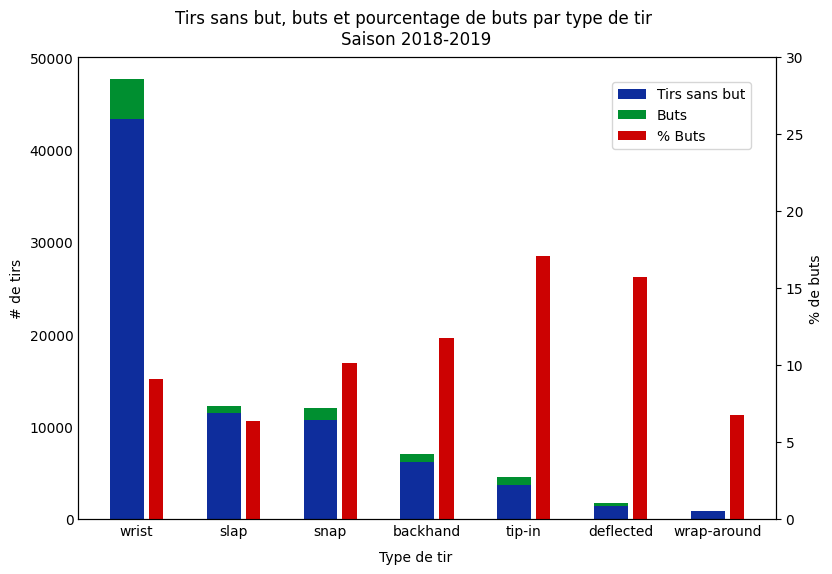
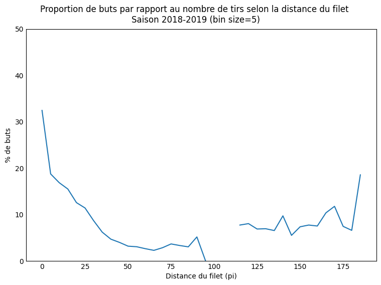

# 1\. Acquisition de données

## Question 1

> [!TIP]
> **Rédigez un bref tutoriel** expliquant comment votre équipe a téléchargé l'ensemble de données. Imaginez :) que vous cherchiez un guide pour télécharger les données play-by-play ; votre guide devrait vous faire dire « Parfait \- c'est exactement ce que je cherchais\! ». **Incluez votre fonction/classe** et **fournissez un exemple de son utilisation**. Assurez-vous de ne pas seulement démontrer que votre code fonctionne \- c'est aussi un exercice de documentation et de communication de votre implémentation. Cela n'a *pas* besoin d'être extrêmement compliqué, mais nous nous attendons à quelque chose d'un peu plus cohérent et digeste que de simples captures d'écran de vos fonctions/code.

> [!WARNING]
> TODO

Voici comment notre équipe a téléchargé l'ensemble de données play-by-play de 2016-17 à 2023-24.

### Guide rapide

Depuis le dossier `data_science_project` :

```bash
uv sync                 # Créé un .venv et installe tout le nécéssaire
uv run download-nhl     # télécharge 2016-17 à 2023-24 (long la première fois)
# Options : `--first 2019 --last 2019` (une seule saison), `--data-dir CHEMIN` (dossier de sauvegarde) et `--delay 0.5` (pause en secondes entre deux requêtes). Le téléchargement peut être interrompu (Ctrl+C) puis relancé. Les matchs déjà sauvegardés sont sautés.
# ex: `uv run download-nhl --first 2019 --last 2019`
```

#### 1. Le point d'accès

L'API web de la LNH retourne un fichier JSON par match :

```
https://api-web.nhle.com/v1/gamecenter/{GAME_ID}/play-by-play
```

Ce JSON contient les événements du match (tirs, buts, mises au jeu, etc.) avec leur période, leur temps et leurs coordonnées sur la patinoire. Pour une saison spécifiée, on télécharge chaque match **une seule fois** et on le garde sur le disque (cache).

#### 2. L'identifiant d'un match

Un `GAME_ID` a 10 chiffres : `AAAA TT NNNN`.

- `AAAA` : année de début de la saison (`2016` pour 2016-17)
- `TT` : type de match, `02` pour la saison régulière et `03` pour les séries
- `NNNN` : en saison régulière, le numéro du match (`0001`, `0002`, ...). En séries, `0RMG` : la ronde (1 à 4), la série dans la ronde et le match de la série (1 à 7)

Par exemple, `2022030411` est la saison 2022-23, séries, ronde 4 (la finale), série 1, match 1. 
Il y a 8 séries en ronde 1, 4 en ronde 2, 2 en ronde 3 et 1 en ronde 4 (la finale).

```python
def regular_season_game_id(season: int, number: int) -> str:
    return f"{season}02{number:04d}"

def playoff_game_id(season: int, round_: int, matchup: int, game: int) -> str:
    return f"{season}030{round_}{matchup}{game}"
```

#### 3. Le cœur `get_game` avec cache

```python
def get_game(game_id, data_dir=None, session=None, delay=0.5):
    path = _cache_path(game_id, data_dir)
    if path.exists():                       # 1. déjà téléchargé : on lit le disque
        return json.loads(path.read_text())

    resp = (session or requests).get(PBP_URL.format(game_id=game_id), timeout=30)
    time.sleep(delay)                       # 2. pause pour ne pas surcharger l'API
    if resp.status_code == 404:             # 3. ce match n'existe pas
        return None
    resp.raise_for_status()

    data = resp.json()
    path.parent.mkdir(parents=True, exist_ok=True)
    path.write_text(json.dumps(data))       # 4. on sauvegarde le JSON brut
    return data
```

La fonction vérifie d'abord le cache. Le premier appel télécharge et sauvegarde, et les suivants lisent le disque sans aucune requête. Un `404` n'est pas une erreur. C'est normal, par exemple pour un match 7 qui n'a pas eu lieu parce que la série s'est terminée en 5 matchs. Et donc, on retourne alors `None`. Sinon, les autres erreurs HTTP sont levées.

Le dossier de sauvegarde est choisi dans cet ordre : l'argument `data_dir`, la variable d'environnement `NHL_DATA_DIR`, puis `data/raw/` par défaut.

```python
def get_data_dir(data_dir=None) -> Path:
    path = Path(data_dir or os.environ.get("NHL_DATA_DIR", "data/raw"))
    path.mkdir(parents=True, exist_ok=True)
    return path

def _cache_path(game_id, data_dir):
    return get_data_dir(data_dir) / game_id[:4] / f"{game_id}.json"
```

Chaque membre de l'équipe peut ainsi mettre les données où il veut (`$env:NHL_DATA_DIR = "D:\nhl"` sous PowerShell, `export NHL_DATA_DIR=~/nhl` sous macOS/Linux) sans conflit de chemins dans git. Les données ne sont jamais commitées dans `data/raw/`. En effet, `data/raw/` est dans le `.gitignore`.

#### 4. Télécharger une saison

On boucle sur les identifiants (version simplifiée, sans barre de progression).

**Saison régulière.** On ne connaît pas à l'avance le nombre de matchs, car il varie d'une saison à l'autre (expansion, COVID). On compte donc 1, 2, 3, ... et on s'arrête après 5 matchs inexistants consécutifs.

```python
def download_regular_season(season, data_dir=None, session=None, delay=0.5, max_misses=5):
    games, misses = [], 0
    for number in range(1, MAX_REGULAR_SEASON_GAMES + 1):
        data = get_game(regular_season_game_id(season, number), data_dir, session, delay)
        if data is None:
            misses += 1
            if misses >= max_misses:
                break
            continue
        misses = 0
        games.append(data)
    return games
```

**Séries.** On parcourt chaque ronde, chaque série et les matchs 1 à 7, et on passe à la série suivante dès qu'un match manque, soit {round: matchups}

```python
MATCHUPS_PER_ROUND = {1: 8, 2: 4, 3: 2, 4: 1}

def download_playoffs(season, data_dir=None, session=None, delay=0.5):
    games = []
    for round_, n_matchups in MATCHUPS_PER_ROUND.items():
        for matchup in range(1, n_matchups + 1):
            for game in range(1, 8):
                data = get_game(playoff_game_id(season, round_, matchup, game), data_dir, session, delay)
                if data is None:
                    break               # la série est terminée
                games.append(data)
    return games
```

`download_season(season, data_dir)` appelle les deux et retourne `{"regular": [...], "playoffs": [...]}`.

#### 5. Exemple d'utilisation

```python
from ift6758.data import get_game, download_season

game = get_game("2022030411")                  # 1er appel : télécharge ; 2e appel : lit le disque
print(list(game.keys()))
print(len(game["plays"]), "événements")

season = download_season(2019, "data/raw")     # saison 2019-20 dans le dossier data/raw
print({k: len(v) for k, v in season.items()})
```

Pour tout télécharger d'un coup : `uv run download-nhl` (~15min par saison la première fois sur nos machines).

## Question 2

> [!TIP]
> **[IFT6758 seulement]** Comparez le comportement de récupération, de mise en cache et de chargement de votre code manuel et de votre code généré par le LLM à l'aide des mêmes tests : un match connu, un accès au cache sans nouvelle requête, et une requête qui échoue. Vérifiez les deux implémentations par rapport aux résultats attendus. Rapportez les itérations de prompts et toute correction manuelle nécessaire.

> [!WARNING]
> TODO

# 2\. Outil de débogage interactif

## Question 1

> [!TIP]
> **Implémentez un ipywidget** (ou un outil interactif de votre choix) qui vous permet de parcourir tous les événements, pour chaque match d'une saison donnée, avec la possibilité de basculer entre la saison régulière et les séries éliminatoires. **Dessinez les coordonnées de l'événement sur l'image de la patinoire fournie**, comme dans l'exemple ci-dessous (vous pouvez simplement afficher les données de l'événement lorsqu'il n'y a pas de coordonnées). Vous pouvez également afficher toute information que vous jugez utile, comme les métadonnées du match/boxscores et les résumés d'événements (mais ce n'est pas obligatoire). **Prenez une capture d'écran de l'outil et ajoutez-la à l'article de blog**, accompagnée du **code de l'outil** et d'une brève description (1-2 phrases) de ce que fait votre outil. Vous n'avez pas à vous soucier d'intégrer l'outil dans l'article de blog.
>
> ***Remarque** : Un bon test de cohérence consiste à comparer un match spécifique avec les données disponibles sur le site web de la LNH, dont un exemple se trouve [ici](https://www.nhl.com/gamecenter/wpg-vs-tor/2017/10/04/2017020001/playbyplay). Vous remarquerez que les coordonnées des événements y sont aussi dessinées, ce qui vous permet de vérifier si vos figures sont valides. Pour vous inspirer, une capture d'écran de l'outil que j'ai rapidement créé se trouve ci-dessous. Mis à part la figure, vous n'avez pas besoin de reproduire cette mise en page ; n'hésitez pas à ajouter toute information que vous jugez utile\!*

*Un exemple de widget interactif que vous pouvez créer pour explorer les données. Celui-ci a été créé avec de simples ipywidgets et matplotlib.*

> [!WARNING]
> TODO

# 3\. Données ordonnées

## Question 1

> [!TIP]
> Dans votre article de blog, **incluez un petit extrait** de votre dataframe final (ex. avec [head(10)](https://pandas.pydata.org/docs/reference/api/pandas.DataFrame.head.html)). Vous pouvez simplement inclure une capture d'écran plutôt que de vous battre pour que les tableaux soient bien formatés en HTML/markdown.

>   Vous remarquerez que le champ « force » (c.-à-d. forces égales, avantage numérique, désavantage numérique) n'existe que pour les buts, pas pour les tirs. De plus, il n'inclut pas le nombre réel de joueurs sur la glace (c.-à-d. 5 contre 4, ou 5 contre 3, etc.). **Discutez** de la façon dont vous pourriez ajouter l'information réelle sur la force (c.-à-d. 5 contre 4, etc.) *aux tirs et aux buts*, compte tenu des autres types d'événements (au-delà des tirs et des buts) et des caractéristiques disponibles. Vous n'avez pas besoin de l'implémenter pour cette étape.

> [!WARNING]
> TODO

## Question 2

> [!TIP]
> En quelques phrases, **discutez d'au moins 3 caractéristiques supplémentaires** que vous pourriez envisager de créer à partir des données disponibles dans cet ensemble de données. Nous ne cherchons pas de réponses particulières, mais si vous avez besoin d'inspiration : un tir ou un but pourrait-il être classé comme un [rebond](https://www.youtube.com/watch?v=-0FiO4jjFuA)/[tir en contre-attaque](https://www.youtube.com/watch?v=V2pjERKAc_8) (expliquez comment vous les identifieriez\!) ?
>    1. **[IFT6758 seulement]** Demandez à un LLM de générer la logique de transformation Pandas pour l'une de vos 3 caractéristiques (ex. rebond). En 2–3 phrases, évaluez l'exactitude et la gestion des cas limites du code généré par le LLM par rapport à votre implémentation manuelle.
>    2. **[IFT6758 seulement]** Refaites entièrement le nettoyage des données avec un LLM et comparez le résultat final et le code à votre méthode.

> [!WARNING]
> TODO


# 4\. Visualisations simples

## Question 1

> **Produisez une figure** comparant les types de tirs de toutes les équipes (c.-à-d. agrégez simplement tous les tirs), pour une saison de votre choix. Superposez le nombre de buts au nombre de tirs. Quel semble être le type de tir le plus dangereux (le plus haut pourcentage de buts, pas le plus grand nombre de buts)? Le type de tir le plus courant? Pourquoi avez-vous choisi cette figure? Ajoutez cette figure et cette discussion à votre article de blog.

L'image, avec une description plus bas:
> 

Le tir le plus dangereux semble être le "tip-in", suivi de près par le "deflected" qui est un peu moins fréquent. Le type de tir le plus courant est le "wrist shot", qui nécessite moins de force qu'un slap shot et moins de chance ou de finition qu'un "deflected shot" ou un "wrap-around". Nous avons choisi un diagramme à bandes, car c'est une représentation très visuelle du nombre total, et nous avons ajouté une bande séparée et plus mince pour illustrer les pourcentages de buts, comme ils peuvent être difficile à mesurer à l'oeil.

## Question 2

> Quelle est la relation entre la distance à laquelle un tir a été effectué et la chance qu'il s'agisse d'un but? **Produisez une figure** pour chaque saison entre 2018-19 et 2020-21 pour répondre à cette question, et ajoutez-la à votre article de blog avec quelques phrases décrivant votre figure. Y a-t-il eu beaucoup de changements au cours de ces trois saisons? Pourquoi avez-vous choisi cette figure?

Les images, avec une description plus bas:
> 
> 
> 

On remarque que les tirs les plus près du buts se convertissent plus souvent en but. Malheureusement, notre méthode pour déterminer le côté où est lancé le tir selon le statut "home" ou "away" et la période a échoué nos checks et nous avons alors assumé que le but était celui le plus proche, donc nous avons des données moins précises en zone neutre (x = [-25, +25]). Il y a eu peu de changement au cours de ces trois saisons. On remarque quelques buts ayant été fait de loin, probablement des but en filet désert, même avec des bins à 5.


## Question 3

L'image, avec une description plus bas:
> 

Les "slap shots" et les "snap shots" de près sont les plus dangereux, qui portent beaucoup de puissance et laissent peu de temps au gardien pour réagir. De loin, les tirs du poigents et les "slap shots" peuvent aussi faire quelques buts, sans oublier la possibilité qu'il y ait des outliers pour les tirs moins fréquents, comme par exemple certains tirs "backhanded" de loin. Il est très normal d'avoir peu de tirs et de buts "tip-in" de loin, de même que "deflected". C'est encore plus vrai pour les tirs "wrap-around" qui sont pratiquement impossibles à faire loi du filet.

## Question 4

> [!TIP]
> **[IFT6758 seulement]** Mettez en place une interface de requêtes par LLM (avec des outils comme PandasAI, une approche *prompt-to-code* maison, ou des appels validés à vos propres fonctions Pandas) pour interroger votre ensemble de données ordonné en langage naturel. PandasAI vous permet de poser des questions sur les données à des LLM et intègre les LLM à d'autres composantes du pipeline, comme la visualisation de données et l'ingénierie de caractéristiques.
>   1. Vous concevrez des prompts et des outils qui permettent au LLM de comprendre des questions sur le hockey, de les convertir en requêtes structurées et de récupérer les réponses dans votre ensemble de données de la LNH.
>   2. Testez des requêtes en convertissant le langage naturel en code ou en appels de fonctions validés, par exemple : « Compare les pourcentages de buts sur tirs du poignet de Montréal et de Toronto en 2020-21 » en une requête que votre code Pandas peut exécuter. Privilégiez la réutilisation de vos fonctions d'analyse vérifiées. Si vous exécutez du code Python généré par un LLM, utilisez un environnement isolé, sans identifiants ni accès à des fichiers personnels.
>   3. Évaluez votre système sur un ensemble fixe de **8 questions d'évaluation**, rédigées avant de commencer à ajuster vos prompts et jamais utilisées pour le développement des prompts. Elles doivent couvrir le filtrage, le regroupement, les pourcentages de buts, les graphiques, et au moins une question à laquelle l'ensemble de données ne permet pas de répondre (ex. sur les passes, qui ne sont pas suivies). Comparez chaque résultat à une réponse de référence que vous avez vérifiée manuellement ; un graphique est correct s'il montre les quantités, le regroupement et la saison demandés. Pour les questions sans réponse possible, le système doit indiquer qu'il ne peut pas répondre plutôt qu'inventer un résultat. **Présentez un tableau** indiquant, pour chaque question : si la première tentative s'est exécutée avec succès, si la réponse/le graphique final est correct, et le nombre de nouvelles tentatives. Discutez d'un succès et d'un échec ou d'une limite ; si aucun échec ne survient, testez une requête supplémentaire plus difficile et discutez-en.

> [!WARNING]
> TODO

# 5\. Visualisations avancées : cartes de tirs

> [!TIP]
> ***Remarque** : le but de cet exercice est de vous familiariser avec l'utilisation des bibliothèques Python standards pour créer des visualisations. Vous ne pouvez pas utiliser d'outil qui crée pour vous des visualisations spécifiques au domaine (c.-à-d. le hockey). Vous êtes libres d'utiliser des bibliothèques standards (matplotlib, seaborn, plotly, bokeh, etc.) pour générer ces graphiques.*

## Question 1

> [!TIP]
> [Exportez les 4 graphiques de zone offensive en HTML](https://plotly.com/python/interactive-html-export/) et **intégrez-les dans votre article de blog**. Votre graphique doit permettre aux utilisateurs de sélectionner n'importe quelle équipe pour la saison sélectionnée.
   ***Note** : Puisque vous pouvez trouver ces figures sur Internet, répondre à ces questions sans produire ces figures* ne *vous rapportera aucun point\!*

> [!WARNING]
> TODO

## Question 2

> [!TIP]
> **Discutez** (en quelques phrases) de ce que vous pouvez interpréter à partir de ces graphiques.

> [!WARNING]
> TODO

## Question 3

> [!TIP]
> Considérez l'Avalanche du Colorado ; regardez leur carte de tirs pendant la saison 2016-17. **Discutez** de ce que vous pourriez dire sur l'équipe pendant cette saison. Regardez maintenant la carte de tirs de l'Avalanche du Colorado pour la saison 2020-21, et **discutez** de ce que vous pourriez conclure de ces différences. Est-ce que cela a du sens? *Indice : regardez le classement*.

> [!WARNING]
> TODO

## Question 4

> [!TIP]
> Considérez les Sabres de Buffalo, une équipe qui a connu des difficultés ces dernières années, et comparez-les au Lightning de Tampa Bay, une équipe qui a remporté la coupe Stanley deux années de suite. Regardez les cartes de tirs de ces deux équipes pour les saisons 2018-19, 2019-20 et 2020-21. **Discutez** des observations que vous pouvez faire. Y a-t-il quelque chose qui pourrait expliquer le succès du Lightning, ou les difficultés des Sabres? Dans quelle mesure pensez-vous que ces figures donnent un portrait complet?

> [!WARNING]
> TODO
